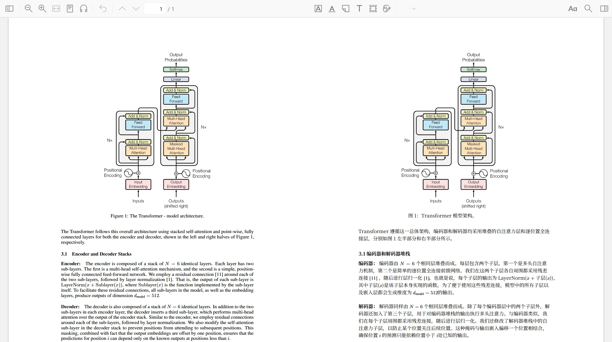
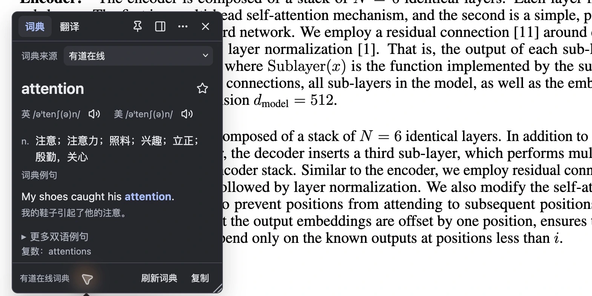

# zotero-pdf2zh-pro

在 Zotero 8–10 中翻译 PDF、对照阅读和划词查义。

[下载正式版](https://github.com/study-233/zotero-pdf2zh-pro/releases/latest) · [官网](https://study-233.github.io/zotero-pdf2zh-pro/) · [使用指南](docs/user-guide.md) · [更新记录](https://study-233.github.io/zotero-pdf2zh-pro/changelog/)

## 阅读与翻译

先按页试译，再提交全文或批量 PDF，译文自动导回原条目。支持术语库、失败补译和 Markdown、JSON、TXT 导出。

选词查释义，选句看译文；在新版译文附件中反查原句，将原文与译文保存为双语笔记。[划词精读指南](docs/user-guide.md#selection-translation)

## 快速开始

**1. 安装插件。** [下载 XPI](https://github.com/study-233/zotero-pdf2zh-pro/releases/latest/download/zotero-pdf2zh-pro.xpi)，在 Zotero「工具 → 插件」的齿轮菜单中选择从文件安装。[安装图解](docs/user-guide.md#installation)

**2. 准备翻译引擎。** Windows 10/11 x64、Windows 11 ARM64 和 Apple Silicon Mac 用户可在插件设置的「翻译服务」中点击「安装本地引擎」，或用「选择安装位置…」指定磁盘。已有服务可填写原地址并点击「测试连接」。

需要独立服务时，可用 [Windows x64 安装器](https://github.com/study-233/zotero-pdf2zh-pro/releases/latest/download/zotero-pdf2zh-pro-windows-x64-setup.exe)、[Homebrew](docs/user-guide.md#macos) 或 [Linux / Docker / uv](docs/user-guide.md#advanced)。Intel Mac 可沿用已有服务。

**3. 配置翻译来源。** 添加配置，填写服务商的 API 地址、Key 和模型，测试后选择「保存并使用」。也可使用 ChatGPT 套餐或本地模型。使用云端模型时，选中的服务商会收到待译文本。[配置指南](docs/user-guide.md#api-configuration)

**4. 试译与阅读全文。** 在文库中右键已下载的 PDF，选择「zotero-pdf2zh-pro → 按页试译」，先检查几页的译文。满意后选择「翻译 PDF」提交全文；任务显示「已导入」后，在原条目下打开双语附件。[操作图解](docs/user-guide.md#usage)

## 使用与维护

- [翻译参数与 OCR](docs/user-guide.md#translation-options) · [术语包](docs/glossary-downloads.md)

- [任务、补译与导入](docs/user-guide.md#task-management) · [请求与用量](docs/user-guide.md#看懂请求详情)

- [更新、迁移与卸载](docs/user-guide.md#maintenance)

- [uv](docs/user-guide.md#uv) · [Docker](docs/user-guide.md#advanced) · [服务端接口](server/README.md)

## 常见问题

| 问题 | 处理 |
| --- | --- |
| 无法连接服务 | 点击「检查本地服务」重试引擎安装；独立服务检查控制中心或 `brew services list`，并核对地址。 |
| 服务已连接，API 测试失败 | 核对服务商的 API 地址、Key 和模型。 |
| 已完成却没有附件 | 在任务列表点击「重试导入」。标为「待补译」的附件可在修复原因后继续补译。 |

[排错指南](docs/user-guide.md#troubleshooting) · [导出诊断包](docs/user-guide.md#diagnostics)

## 反馈与贡献

- [报告问题](https://github.com/study-233/zotero-pdf2zh-pro/issues/new?template=%E9%97%AE%E9%A2%98%E5%8F%8D%E9%A6%88.md)
- [提出功能建议](https://github.com/study-233/zotero-pdf2zh-pro/issues/new?template=%E5%8A%9F%E8%83%BD%E5%BB%BA%E8%AE%AE.md)
- [查看现有 Issues](https://github.com/study-233/zotero-pdf2zh-pro/issues)

反馈时请提供操作系统、Zotero 版本、插件与服务端版本，以及复现步骤和报错。
卡顿或任务失败可附上[诊断包](docs/user-guide.md#diagnostics)；分享截图或日志前移除密钥和私人内容。

[开发待办](docs/development-notes.md#待开发) · [开发维护笔记](docs/development-notes.md) · [文档规范](docs/readme-maintenance.md)

## Star History

  <a href="https://www.star-history.com/?repos=study-233%2Fzotero-pdf2zh-pro&amp;type=date&amp;legend=top-left">
    <picture>
      <source media="(prefers-color-scheme: dark)" srcset="https://api.star-history.com/chart?repos=study-233/zotero-pdf2zh-pro&amp;type=date&amp;theme=dark&amp;legend=top-left" />
      <source media="(prefers-color-scheme: light)" srcset="https://api.star-history.com/chart?repos=study-233/zotero-pdf2zh-pro&amp;type=date&amp;legend=top-left" />
      
    </picture>
  </a>

## 项目来源

本项目基于 [NightWatcher314/zotero-pdf2zh-next](https://github.com/NightWatcher314/zotero-pdf2zh-next) 的 `v5.3.0` 继续开发，该项目源自 [guaguastandup/zotero-pdf2zh](https://github.com/guaguastandup/zotero-pdf2zh)。 
感谢上游维护者及所有贡献者。

## License

本项目采用 **AGPL-3.0-or-later**，保留上游项目与第三方组件的许可证及归属。
详见 [LICENSE](LICENSE) 和 [第三方声明](server/THIRD_PARTY_NOTICES.md)。

[release-version]: # (<!-- release-version --> `1.9.9`)
