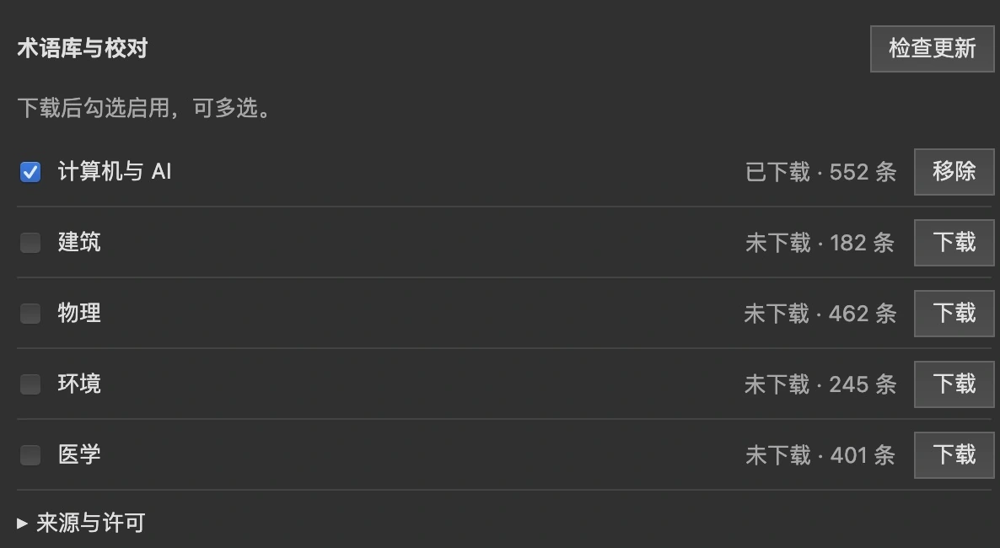

# 使用术语库

<!-- Generated from website/src/content/docs/guide/*.mdx. Edit those chapters, then run python scripts/sync_guide_docs.py. -->

让同一术语在全文中使用一致译法。先确认本地服务已连接。

## 下载并启用

1. 展开 **设置 → zotero-pdf2zh-pro → 术语库与校对**，点击所需词库的 **下载**。
2. 下载完成后 **勾选启用**，可以同时使用多个词库。
3. 提交新翻译任务，所选术语会应用到全文。

下载包适用于 **英语 → 简体中文**；其他语言不应用包内词条。自定义 CSV 按其语言设置使用。
词库下载后可离线使用；“检查更新”只刷新目录，点击“更新”才下载新版。

## 译法冲突与重试

- 自定义译法优先；同词同译合并。
- 不同词库提供冲突译法且没有自定义覆盖时，由上下文翻译决定，不按勾选顺序选择。
- 已创建任务保存术语快照，重试和补译不受后续词库更新影响。

## 数据与故障

词库位于服务数据目录的 `glossaries/`；实际目录以 `/health` 中的 `workspace.path` 为准。
迁移或升级前请[备份数据](user-guide.md#maintenance)。

| 问题 | 处理 |
| --- | --- |
| 没有术语库管理入口 | 更新本地服务 |
| 升级后显示未下载 | 检查是否连接了正确服务和数据目录；旧目录已清理且无备份时需重新下载 |
| 指定版本缺失或损坏 | 重新下载，或取消勾选后提交新任务 |
| 发现多个旧数据目录 | 保持服务停止，备份并合并后再启动，迁移完成前不要清理旧版本 |

移除词库会删除该词库的全部安装版本；不会删除任务内的独立快照。清理任务也不会删除公共词库。

来源与许可见[词库来源说明](glossary-sources.md)，开发接入见[服务端接口](../server/README.md#glossary-pack-api)。
