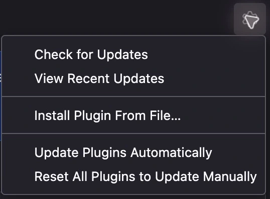
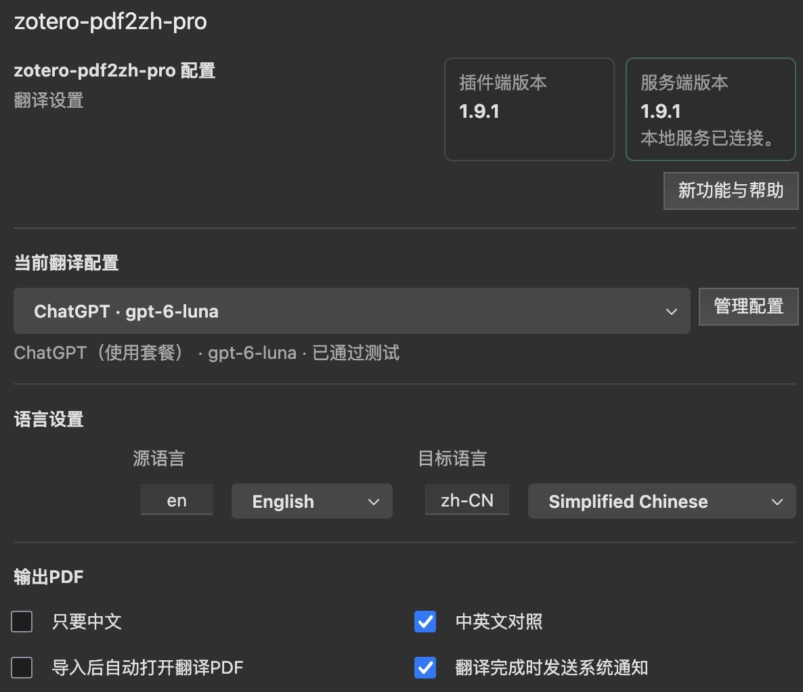
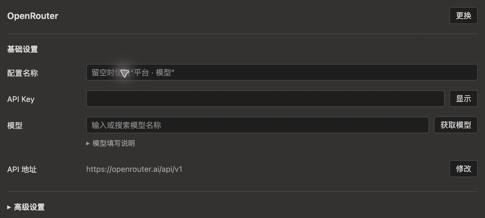
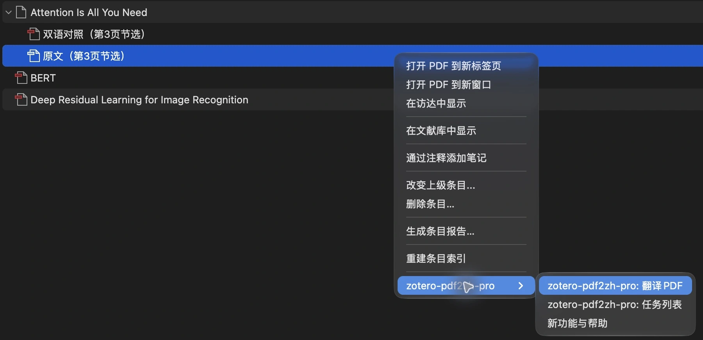
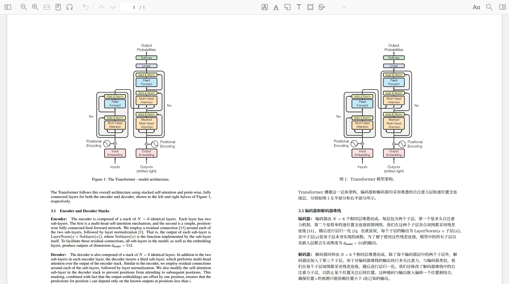
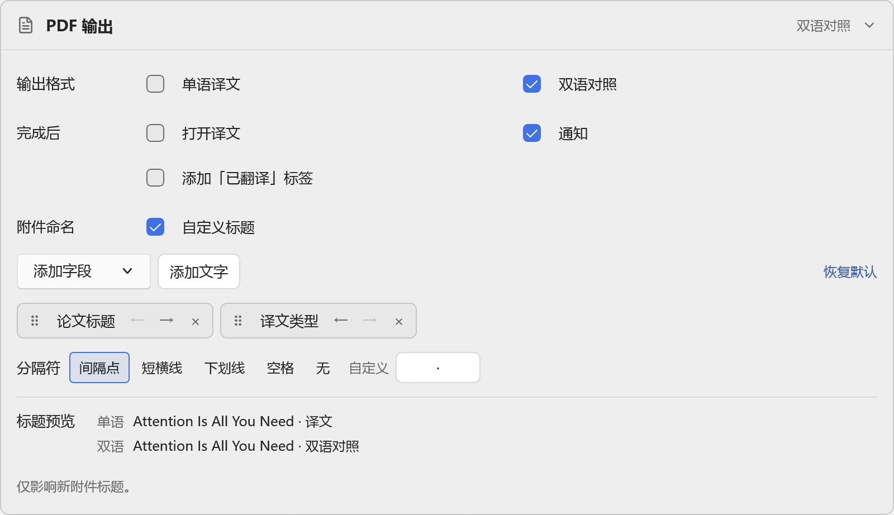
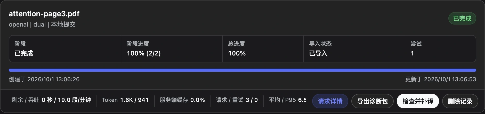
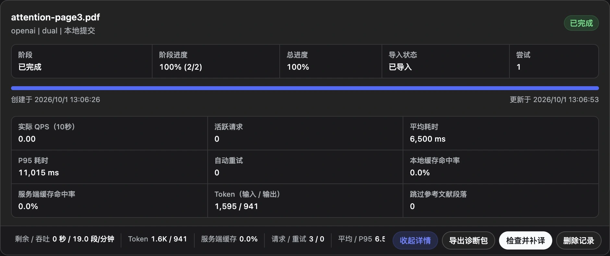
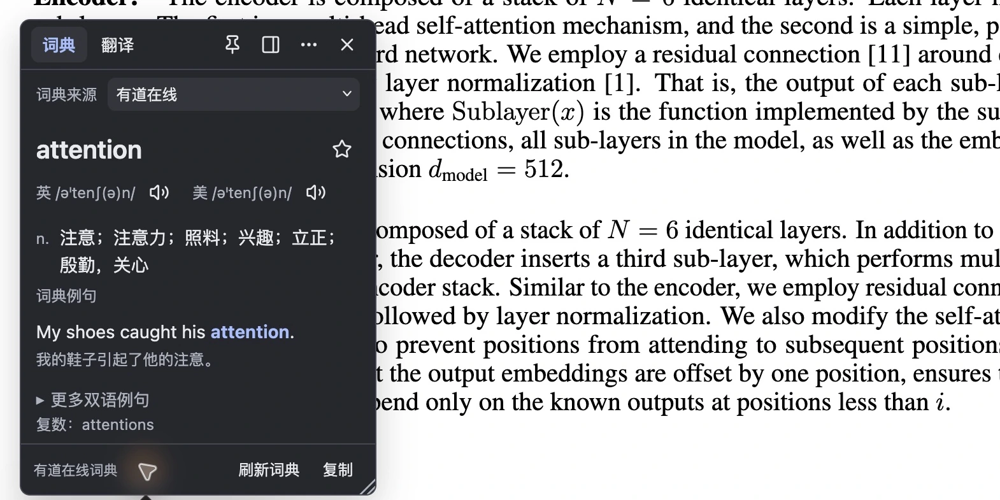

# 使用指南

[返回项目首页](../README.md)

按 **安装本地服务 → 安装插件 → 配置 API → 翻译 PDF** 完成首次使用。

## 目录

- [安装前准备](#quick-start)
- [Windows 安装](#windows) · [macOS 安装](#macos) · [uv 手动运行](#uv)
- [安装插件与检查连接](#installation)
- [配置翻译 API](#api-configuration)
- [第一次翻译 PDF 与附件命名](#usage)
- [常用翻译参数](#translation-options)
- [任务管理、请求指标与补译](#task-management)
- [Reader 划词与翻译记忆](#selection-translation)
- [更新与日常维护](#maintenance)
- [常见问题与排查](#troubleshooting) · [诊断导出](#diagnostics)
- [Linux / Docker 部署](#advanced)

<a id="quick-start"></a>

## 1. 安装前准备

### 需要安装哪些东西？

- **Zotero 8、9 或 10**：用于管理与阅读论文，先从 [Zotero 官网](https://www.zotero.org/download/)安装。
- **本地翻译服务**：Windows 使用[控制中心](#windows)，macOS 使用 [Homebrew](#macos)；Linux / Docker 用户查看[部署教程](#advanced)。服务负责处理 PDF 和生成结果。
- **Zotero 插件（`.xpi`）**：服务就绪后，[下载插件](https://github.com/study-233/zotero-pdf2zh-pro/releases/latest/download/zotero-pdf2zh-pro.xpi)并[装入 Zotero](#installation)，获得设置和任务入口。
- **翻译来源**：准备服务商提供的 API 地址、Key 和模型名，或使用已有的 [ChatGPT 套餐登录](#使用-chatgpt-套餐登录)。已有本地模型时也可选择 Ollama。

**插件和本地服务都需要安装。** Windows 控制中心和 macOS Homebrew 会自动处理 Python 环境。

### 两种地址不要填反

- **本地服务地址**：`http://127.0.0.1:8890`，填在插件设置底部的“本地服务地址”。
- **翻译 API 地址**：由服务商提供，填在“新增翻译配置”的“API 地址”。例如 `https://api.example.com/v1`，这只是结构示例，不是可用接口。使用 ChatGPT 套餐登录时无需填写此项。

工作流：`Zotero → 本地服务 → 翻译 API → 本地生成 PDF → 导入 Zotero`。

PDF 在本地处理；使用云端 API 时，待翻译文本会发送给所选服务商，并消耗其 API 额度。

> [!TIP]
> 第一次先用一篇篇幅较短、能够选中文字的 PDF 验证流程。默认已勾选“禁用术语提取”，建议保持：术语提取会额外消耗较多 token。

<a id="windows"></a>

## 2. Windows 安装教程

适用于 **Windows 10/11 x64**。安装 EXE 内置服务程序，首次安装仍需联网准备 Python 和翻译依赖。

### 第一步：下载并打开安装器

1. 打开 [最新 Release](https://github.com/study-233/zotero-pdf2zh-pro/releases/latest)，展开发布页底部的 **Assets**。
2. 下载 `zotero-pdf2zh-pro-windows-x64-setup.exe`，同时下载 `zotero-pdf2zh-pro.xpi`，稍后装入 Zotero。
3. 双击安装 EXE。控制中心、安装文件和配套服务程序已内置，无需解压。

### 第二步：选择安装位置并安装

1. 在向导中确认安装位置、登录自启和自动更新选项，点击 **“开始安装”**。
2. 下载文件时显示当前文件的实际字节数、百分比和速度；准备 Python 和依赖时，用活动指示器、步骤和已用时间表示正在处理，不显示无法计算的总体百分比。
3. 安装完成后，点击 **“打开控制中心”**，等待出现 **“翻译服务已就绪”**。

默认安装到 `%LOCALAPPDATA%\zotero-pdf2zh-pro`，首次安装可以选择其他磁盘。
已有安装会保留目录、配置、数据和自启选择；同版本安装可修复，高版本安装可升级，禁止降级。

从 v1.8.2 或更早版本升级时，先等待翻译完成，再从旧控制中心停止服务后运行新安装器。旧服务尚不支持维护保护，正在运行时安装器会保留已准备的新环境并提示停止服务，不会强制中断翻译。
安装或更新期间可以后台运行，在托盘重新打开窗口可继续查看进度。Python 和依赖按文件显示下载量、速度和百分比；无法取得总量时显示当前步骤和耗时，不显示循环进度条。“操作详情”在当前页展开，可滚动查看并复制日志；向上滚动会暂停跟随，点击“回到最新”恢复。失败时详情自动展开，可以重试或打开日志。设置页的“关于”提供版本、License 与致谢。

### 第三步：保持服务运行并安装插件

服务地址保持 `http://127.0.0.1:8890`，接着完成[安装 Zotero 插件](#installation)。

- **关闭主窗口**会销毁面板并保留托盘；重新打开控制中心可继续查看状态。
- **退出控制中心**也不会停止已经运行的翻译服务。需要停止时，点击“停止服务”。
- **登录自启**默认开启，登录 Windows 时自动启动服务并进入托盘，可随时关闭。
- **设置 → 外观与启动**可切换跟随系统、浅色或深色主题。更新、安装目录、日志和维护工具也在设置中。
- 安装通常无需管理员权限；若 8890 端口被占用，先检查是否已有服务运行。

### 如果控制中心打不开

- 原生控制中心支持 Windows 10/11 x64，不依赖 WebView2 或额外 VC++ 运行库。首次安装翻译服务仍需联网准备 Python 和依赖。
- 如果旧版提示缺少 `WebView2Loader.dll`，请下载新版 Windows 安装 EXE，双击后按向导安装或升级；无需先卸载原版，已有配置和翻译记录会保留。
- 当前 EXE 未签名，Windows SmartScreen 可能提示风险。请只从本项目 Release 下载，并核对发布页提供的 SHA-256。
- 图形界面仍无法使用时，可查看 [Windows 说明](../scripts/windows/README.txt)，从安装目录的 `bin` 文件夹使用 `install.cmd`、`start-server.cmd` 或 `view-log.cmd` 等故障恢复入口。

<a id="macos"></a>

## 3. macOS 安装教程

推荐使用 **Homebrew 后台服务**，关闭终端后仍能运行。下面的命令在“应用程序 → 实用工具 → 终端”中执行，每段执行完成后再继续。

### 第一步：确认 Homebrew 可用

```bash
brew --version
```

能看到 Homebrew 版本号即可继续。如果提示 `command not found: brew`，请先按 [Homebrew 官方安装说明](https://brew.sh/)安装，并完成安装结束时提示的 **Next steps**，然后重新打开终端再检查。

### 第二步：安装本地服务

```bash
brew tap study-233/formula
brew install --build-from-source study-233/formula/zotero-pdf2zh-pro
```

首次安装会下载源码和依赖，耗时取决于网络和机器。等待命令结束、终端重新出现输入提示符，再继续启动服务。

### 第三步：启动并验证

```bash
brew services start zotero-pdf2zh-pro
brew services list
```

在列表中找到 `zotero-pdf2zh-pro`，检查状态是否为 `started`。再执行：

```bash
curl -fsS http://127.0.0.1:8890/health
```

返回包含 `"status":"ok"` 的 JSON 即表示服务已启动；接下来安装插件并配置 API。
也可以在浏览器中打开 [本地健康检查](http://127.0.0.1:8890/health)。

上述 `brew services start` 在不使用 `sudo` 时会注册当前用户登录启动，终端可以关闭。具体行为见 [Homebrew services 文档](https://docs.brew.sh/Manpage#services-subcommand)。
现在继续[安装 Zotero 插件](#installation)。

### 日常启动、停止和查看日志

| 操作 | 命令 |
| --- | --- |
| 查看状态 | `brew services list` |
| 启动并启用登录启动 | `brew services start zotero-pdf2zh-pro` |
| 停止并取消登录启动 | `brew services stop zotero-pdf2zh-pro` |
| 重启服务 | `brew services restart zotero-pdf2zh-pro` |
| 查看最近日志 | `tail -n 100 "$(brew --prefix)/var/log/zotero-pdf2zh-pro.log"` |

翻译进行中请保持服务运行；重启或停止前先处理当前任务。

<a id="uv"></a>

### 备用方式：使用 uv 手动运行

如果不使用 Homebrew 管理此服务，可按 [uv 官方安装说明](https://docs.astral.sh/uv/getting-started/installation/)准备 uv，然后执行：

```bash
uv tool install --python 3.13 zotero-pdf2zh-pro
uv tool update-shell
```

重新打开终端，再启动：

```bash
zotero-pdf2zh-pro
```

这是前台运行方式，**翻译时保持该终端打开**；按 `Ctrl+C` 停止。默认仍使用 `http://127.0.0.1:8890`，验证方法与 Homebrew 相同。
如果命令找不到，先确认已重新打开终端，并用 `uv tool list` 检查安装结果，参见 [uv 工具使用说明](https://docs.astral.sh/uv/guides/tools/)。

Homebrew 和 uv 选择一种运行方式即可。切换到 uv 前，先停止已有 Homebrew 服务，避免两份服务争用 8890 端口。

<a id="installation"></a>

## 4. 安装 Zotero 插件与检查连接

Windows 和 macOS 使用同一个 XPI 文件。

### 安装 XPI

1. [下载 Zotero 插件 .xpi](https://github.com/study-233/zotero-pdf2zh-pro/releases/latest/download/zotero-pdf2zh-pro.xpi)；不需要解压 XPI。历史版本见 [Release](https://github.com/study-233/zotero-pdf2zh-pro/releases/latest)。
2. 打开 Zotero，进入 **“工具 → 插件”**（英文界面为 `Tools → Plugins`）。
3. 点击右上角齿轮按钮，选择 **“Install Plugin From File…”**。部分版本显示为 `Install Add-on From File…`，均为从文件安装插件。
4. 选择下载的 XPI，按提示完成安装并重启 Zotero。
5. 回到插件列表，确认 `zotero-pdf2zh-pro` 已启用。



### 打开设置并检查本地服务

1. Windows：进入 **“编辑 → 设置”**；macOS：进入 **“Zotero → 设置”**，也可按 `⌘,`。
2. 在左侧选择 **“zotero-pdf2zh-pro”**。
3. 找到下方“服务端连接”，确认 **“本地服务地址”** 为 `http://127.0.0.1:8890`。
4. 点击 **“检查本地服务”**，确认显示连接成功。



如果提示“本地服务无法连接”，先回到 Windows 控制中心或 macOS 服务状态检查。修改 API Key 无法修复本地服务未启动的问题。

<a id="api-configuration"></a>

## 5. 配置翻译 API

### 新增第一个配置

在插件设置顶部点击 **“添加翻译配置”**；已有配置时点击 **“管理配置 → ＋新增”**。
按你已有的条件，选择一条配置路径即可：

- **已有 API 地址和 Key**：继续下面的[填写 API 配置](#填写-api-配置)。
- **使用 ChatGPT 套餐**：直接查看[套餐登录步骤](#使用-chatgpt-套餐登录)，不填 API Key 或 API 地址。
- **已有本地模型或其他接口**：查看[接口类型与模型来源](#接口类型与模型来源)，按对应平台填写。

### 填写 API 配置

在同一窗口中完成选择、测试和保存。第一次使用时，高级设置保持默认即可。

1. 选择平台。OpenRouter 自动填写 `https://openrouter.ai/api/v1`；自定义接口填写平台提供的地址。
2. 填写自己的 API Key。配置名称可留空，保存时使用“平台 · 模型”。
3. 点击 **“获取模型”** 并输入关键词搜索，使用方向键和回车选择；也可直接手填模型 ID。不会自动选中列表第一项。
4. 点击 **“测试”**，使用当前表单发送一条短翻译请求，可能消耗少量 API 额度。
5. 点击 **“保存并使用”**，设为当前翻译配置；**“保存”** 只保存编辑，不切换配置。

测试成功并保存后，继续[翻译第一篇 PDF](#usage)。多配置、协议和旧版迁移说明在本页后面，需要时再查看。



预设地址显示在表单摘要中，点击“修改”可编辑。获取模型失败时仍可手填，不代表一定无法翻译。
推理、协议、额外请求参数、CLI 路径集中在“高级设置”。
OpenRouter 配置使用 OpenAI 兼容接口，模型名称包含平台返回的完整前缀；参考[官方模型目录文档](https://openrouter.ai/docs/api/api-reference/models/list-all-models-and-their-properties)。

### 接口类型与模型来源

| 分类 | 平台 |
| --- | --- |
| 中转平台 | OpenRouter、自定义 OpenAI 兼容 |
| 官方接口 | ChatGPT（使用套餐）、OpenAI、DeepSeek、Gemini、阿里云百炼、SiliconFlow |
| 本地与账号 | Ollama、Claude Code |
| 专用翻译 | DeepL |

11 个平台入口复用 9 种底层服务。OpenRouter、自定义兼容、OpenAI、DeepSeek、Gemini、SiliconFlow 和 ChatGPT 支持获取模型列表；其他平台手填模型。

| 平台 | 配置要点 |
| --- | --- |
| SiliconFlow | 使用自己的 API Key；免费代理已移除 |
| 阿里云百炼 | 从控制台复制业务空间、地域对应的 OpenAI 兼容地址与模型 |
| Ollama | 填写主机地址及已安装模型名，不需要 API Key |
| Claude Code | 提前登录；可在高级设置填写服务所在电脑的 CLI 路径 |
| DeepL | 只填写密钥，不显示模型和 API 地址 |

Zhipu、Grok、Groq、ModelScope、QwenMT、Azure 两类服务、XInference、AnythingLLM 的专用支持已移除。
这些旧配置保留为“需重新配置”，可查看原参数、更换平台或删除；不会自动切换来源，也不会把旧密钥带入新平台。
完整兼容记录见[接口审计](provider-audit-2026-10-03.md)。

### 使用 ChatGPT 套餐登录

在「官方」分类选择 **ChatGPT（使用套餐）**，点击「使用 ChatGPT 登录」，在浏览器为本插件授权并允许使用套餐。完成后返回 Zotero，获取模型、测试后保存；不填写 API Key 或 API 地址。全文和选段翻译都可使用。

点击「管理 ChatGPT 套餐用量」打开官方用量设置。本机调用和 Token 统计由服务继续记录，不在登录界面显示。登录管理需要同一电脑上的原生本地服务；Docker 与远程登录向导暂不支持。

旧 Codex 翻译配置会自动删除，并提示使用 ChatGPT 登录。请新增 ChatGPT 配置，登录并测试后保存使用；独立选段若引用旧配置，也需重新选择。清理前保留本地备份，当前界面不再提供恢复 Codex 的入口。详细账号、代理、用量口径和备份说明见 [ChatGPT 套餐指南](chatgpt-account.md)。

<a id="使用-codex-登录配置自-v181-起"></a><!-- 保留旧链接 -->

### 使用 Codex 登录配置

旧 Codex 配置已停止使用并自动清理，请改用 [ChatGPT 套餐登录](#使用-chatgpt-套餐登录)。历史版本的安装与排错记录保留在 [Codex 验收指南](codex-acceptance.md)。

### API 地址怎么填？

以下均为地址结构示例，需替换成服务商提供的真实地址：

| 服务商给出的地址形式 | 填写方式 |
| --- | --- |
| Base URL：`https://api.example.com/v1` | 原样填写，包括 `/v1` |
| 带自定义前缀：`https://api.example.com/gateway/v1` | 保留整个前缀 |
| 完整 Chat Completions 地址：`https://api.example.com/v1/chat/completions` | 可原样填写 |
| 完整 Responses 地址：`https://api.example.com/v1/responses` | 可原样填写 |

插件**不会自动补 `/v1`**。不要根据示例擅自给服务商地址增加或删除路径，也不要把本地服务地址填到这里。

### 高级设置：协议和额外请求参数

新增配置默认使用 **Chat Completions**。如果服务商明确要求某种协议，可展开“高级设置”，选择 Chat Completions 或 Responses。

- 如果填写的是完整端点，手动选择的协议须与 `/chat/completions` 或 `/responses` 后缀一致。
- 自动识别仅在明确不支持接口时尝试另一协议；鉴权、模型、参数、限流和超时错误会直接提示。任务开始后固定使用已确定的协议。
- 可手动切换到自动识别；已有配置的协议保持原值。遇到协议不支持时，检查服务端更新。
- Responses 全文翻译逐段同步请求，选文翻译支持流式显示，各请求默认 `store=false`；要求工具调用的接口不适用。

“额外请求参数（JSON）”留为 `{}` 即可。只有服务商要求时再填写，例如：

```json
{
  "max_output_tokens": 4096,
  "reasoning": { "effort": "low" }
}
```

此处只是参数格式示例，并非所有模型都支持这些字段。常用字段会随协议转换，中转站扩展字段直接透传；冲突参数会报错。
不能覆盖模型、翻译输入、执行方式、会话、工具或连接设置。“内部配置参数”用于兼容旧配置，新手保持不变即可。

### 管理多个配置

- “当前翻译配置”按 **“配置名称 · 模型”** 展示，选中后立即用于后续新任务，无需额外激活。
- 点击“管理配置”，左侧选中配置只改变编辑对象；“当前使用”标记表示实际翻译来源，点击“保存并使用”才切换。
- 配置窗口默认约 1100×780，小屏会缩小到屏幕可用范围。左侧是配置列表，右侧为基础设置与折叠的高级设置；两侧内容分别滚动，底部操作按钮始终可见。
- 当前使用配置有文字标记，未保存草稿以圆点标记。模型与地址填写说明、较长的测试反馈可展开查看；密钥切换配置后恢复隐藏。
- 复制、置顶与删除在配置行的“⋯”菜单中；窄窗口使用顶部配置选择栏和更多菜单。
- 切换配置或平台会保留窗口内草稿；关闭时存在未保存修改才提示。更换平台使用独立的密钥和参数草稿。
- 删除当前配置后，需要重新选择一个配置，不会自动改用其他中转站。
- 同一批翻译固定使用提交时的配置，后续切换或编辑只影响新批次。
- 翻译缓存按 provider、模型、语言和提示词等配置隔离；修改协议或请求参数也会隔离缓存。

<details>
<summary>从旧版升级后，为什么显示“请选择配置”？</summary>

首次迁移会备份旧配置，并迁移原服务下唯一激活项。如果无法确定应使用哪项，会显示“请选择配置”，需要手动选择并测试。
早期未知服务类型有地址和模型时会转为自定义兼容并标记待测试；本轮明确移除的九种服务保留原服务标识，需手动重新配置。
旧配置备份保存在 Zotero 高级配置的 `extensions.zotero.pdf2zhpro.llmApisLegacyBackup`，其中包含原凭据，不要公开分享。

</details>

<a id="usage"></a>

## 6. 第一次翻译 PDF

先用一篇篇幅较短、能够选中文字的 PDF 走通流程：**确认设置 → 右键翻译 → 打开双语附件**。附件命名和批量任务可以稍后再设置。

### 设置语言与输出

回到插件设置，先确认“当前翻译配置”已经选好。

- 英文论文译成简体中文：源语言选择 `English`（`en`），目标语言选择 `Simplified Chinese`（`zh-CN`）。
- “PDF 输出”默认勾选 **“双语对照”**；需要译文版时勾选 **“单语译文”**，也可以两项同时勾选。至少保留一种输出。
- “PDF 输出 → 完成后 → 打开译文”默认关闭；需要完成后立即阅读时再开启。

输出选项的中文名称以英译中为例；实际译文语言由“目标语言”决定。

### 从文库提交任务

1. 在 Zotero 文库中找到论文，展开条目，确认存在 **本地 PDF 附件**；先双击原 PDF，确认能够打开。
2. 右键该 PDF 附件，展开 **“zotero-pdf2zh-pro”** 子菜单，选择 **“zotero-pdf2zh-pro: 翻译 PDF”**。
3. 插件会打开任务列表并提交任务。可以查看当前阶段和总进度。
4. 等待任务完成，确认 **“已导入”**，回到原条目下打开译文附件。




### 确认结果并开始阅读

任务完成后，确认任务列表的导入状态为 **“已导入”**。展开原论文条目，双击新增的 **“双语对照”** 附件，就能并排阅读原文与译文。

第一次使用成功后，再按需要调整下面的批量任务和附件标题。



英文界面的对应入口为 `zotero-pdf2zh-pro: Translate PDF` 和 `zotero-pdf2zh-pro: Task Manager`。

也可以右键论文父条目，由 Zotero 选择其最佳附件。**一篇论文有多个 PDF 时，直接选择要翻译的原 PDF 更明确**，避免选到补充材料或已经翻译的附件。
只有网页链接、尚未同步到本地的文件或非 PDF 附件无法直接翻译；先下载或附加原 PDF。

### 批量翻译与完成后检查

多选条目或 PDF 后使用同一翻译入口即可批量提交。第一次建议单篇验证，确认输出和 API 配置正确后再批量处理。

- 翻译期间保持本地服务运行；让 Zotero 保持打开，便于跟踪任务和及时导入附件。
- 不要只看进度是否达到 100%，还要看任务最终状态和“导入状态”。
- PDF 导入失败时，查看[任务管理中的“重试导入”](#task-management)；仍有段落失败时，使用独立的“补译”操作。

### 自定义附件标题

这一步可选，不影响第一次翻译。默认组合为“论文标题 → 译文类型”，例如 `Attention Is All You Need · 双语对照`。

<details>
<summary>展开附件标题的自定义方法与命名规则</summary>

1. 开启 **“自定义译文附件标题”**，点击“添加字段”选择论文标题、作者、年份、模型等内容。
2. 拖动手柄调整顺序，或使用前移、后移按钮；手柄聚焦后也支持 `Alt + 方向键`。点击 × 删除字段。
3. 用“添加文字”加入“精读版”等固定文字，选择分隔符，查看下方单语与双语标题预览。有效修改自动保存。



| 规则 | 行为 |
| --- | --- |
| 论文标题 | 优先短标题，其次完整标题，最后原 PDF 文件名；“完整标题”字段始终使用完整题名 |
| 字段与文字 | 同一字段只能添加一次，固定文字可添加多块；缺少的字段自动跳过 |
| 分隔符 | 可选间隔点、短横线、下划线、空格或无，也可自定义 |
| 删除全部内容 | 保留上次有效设置，添加内容后再保存 |
| 关闭 / 恢复默认 | 关闭后使用输出文件名，重新开启恢复组合；“恢复默认”重置字段和分隔符 |
| 生效范围 | 仅影响之后导入的附件标题，不修改 PDF 文件名或已有附件；模型、语言取自任务记录 |

未完成的附件仅在标题末尾追加“（待补译）”；首次完成和补译完成的附件使用相同标题规则，不追加段落数或轮次。旧模板自动转换；无法转换时按界面提示恢复默认后编辑。

</details>

在 **PDF 输出 → 完成后** 中，可开启 **“为完整译文添加「已翻译」标签”**（默认关闭）。完整的单语、双语译文附件导入时添加同名标签，沿用当前文库已有的“已翻译”标签及颜色；当前文库没有该标签时创建同名标签，不自动设置颜色。原 PDF 与论文父条目的标签不变，未完成附件不添加。

标签开关以开始导入时的设置为准，同一任务的单语和双语附件保持一致。关闭后不移除已有标签，也不为历史附件补标；附件标题规则独立于此开关。

<a id="translation-options"></a>

## 7. 常用翻译参数

在插件设置中展开 **“高级翻译参数”**：

| 设置 | 默认值 | 使用说明 |
| --- | --- | --- |
| 最大 QPS | `10` | 限制每秒请求速率；遇到 429 或站点限流时降低 |
| 并发池大小 | `50` | 控制同时处理的并发规模；提高不一定更快，需匹配 API 限制 |
| 最后几页跳过翻译 | `0` | 需要保留文末附录等内容时，填写跳过页数 |
| 不翻译参考文献 | 关闭 | 开启后跳过识别到的参考文献区，输出 PDF 仍保留原文 |
| 翻译表格内文字 | 开启 | 表格中的文字也参与翻译 |
| 自动 OCR 兼容模式 | 开启 | 允许翻译引擎按需启用 OCR 处理 |
| 强制 OCR 兼容模式 | 关闭 | 针对扫描或文本识别异常的 PDF 排查时尝试，无需每篇都开启 |
| 禁用术语提取 | 开启 | 建议保持勾选，避免额外消耗大量 token |
| 跳过文本安全检查 | 关闭 | 通常保持默认，不作为通用的报错修复方式 |
| 字体族 | `auto` | 默认自动选择字体 |
| 禁用水印 | 开启 | 不添加翻译水印 |

起步建议：**QPS 2、并发池 4**，单篇验证后按服务商限额调整。

参考文献保护优先使用 PDF 版面标签，并在证据充分时结合 `References`、`Bibliography` 或 `参考文献` 标题识别；复杂排版仍建议人工核对。

<a id="task-management"></a>

## 8. 任务管理、请求指标与补译

右键文库条目，打开 **“zotero-pdf2zh-pro → zotero-pdf2zh-pro: 任务列表”**。



任务窗口按历史页加载记录：每个服务每页 30 条，可用列表底部页码两侧的箭头切换。活动、待恢复和有结果待导入的任务始终显示，翻页不影响进度与自动导入。状态筛选及其数量针对当前加载列表；“重试本页失败”处理当前列表中的失败任务，“清理失败记录”仍清理相应服务的全部失败记录。服务重启后会自动回到第一页。连接旧服务端时保留原来的完整列表。

重试和补译沿用原任务保存的校对设置，不受当前设置开关影响。卡片仅展示简短状态，
校对摘要显示已检查段落的范围、修正数和问题数，完整覆盖范围与限制可在“详情”查看。

### 按任务状态选择操作

| 看到的状态或问题 | 应该做什么 |
| --- | --- |
| 排队中、运行中 | 等待阶段更新，查看服务和请求指标；同一附件、文件与配置的重复提交会复用活动任务 |
| 待恢复（可在状态详情查看中断类型） | 点击“继续任务”，或在顶部点击“继续上次队列”按原排队顺序恢复 |
| 失败 | 先查看错误原因，修复连接或 API 问题后点击“重试任务” |
| 未完成，仍有应译段落失败 | 点击“补译”，保留已验证译文，只请求剩余段落 |
| 已完成，但导入失败 | 点击“重试导入”，重试拉取和导入已有结果，不重新翻译全文 |
| 已完成，但怀疑部分内容漏译 | 点击“检查并补译”，重新检查历史结果并补齐 |
| 不再需要保留的任务 | 核对结果已妥善保存后再用“删除记录” |

仍有段落失败时，任务显示“未完成”。已生成的 PDF 会自动导入，附件标题仅追加“（待补译）”；剩余段落数和轮次在任务管理中查看。重开 Zotero 后会恢复待导入结果。
补译默认使用 QPS 2、并发 4；修复输出新增附件，完整版本不再追加状态或轮次，保留旧附件及其批注。已导入的历史附件不自动改名。补译仍可能消耗 API 额度；“重试导入”只重新获取 PDF，不发起翻译请求。

服务重启后，尚未开始的任务和执行中断的任务会保留在列表中，等待继续。继续时沿用原配置与检查点，已验证的段落译文可复用；主动取消的任务不会加入恢复队列。原始 PDF 或任务目录已删除时无法继续。

提交响应因断线丢失时，新版插件会在服务端声明支持去重后使用同一编号重试一次；仍失败时保留该编号，重开 Zotero 后从原附件以相同配置再次提交可找回原任务。任务已完成后主动发起的新提交可创建新任务。不同附件分别记录；旧服务端不自动重试结果未知的提交。

任务卡片指标栏的“耗时”是实际排队时间与执行时间之和，从服务接收任务开始计算，不包含上传、Zotero 导入、停机和等待点击继续的时间。继续任务累加已有时间；重试或补译开启新一轮统计。强制退出后未保存的时间不推算，显示“耗时（部分）”；旧任务没有记录时不显示耗时。排队与执行耗时拆分保留在“详情”。

新版插件与服务端之间直接上传 PDF 二进制文件，单文件最多 512 MiB；旧服务端继续使用原上传方式。上传等待最长 10 分钟，超时后按相同提交编号重试可找回已接收的任务。

任务列表与操作请求会等待完整响应，并在超时后结束等待；PDF 结果下载允许更长时间，但长时间没有收到数据仍会超时。下载失败可重试导入，不必重新翻译。

新导入的译文附件会与本地导入凭据一起保存。即使在附件写入后、任务卡片更新前退出，重启后也会识别已有附件，保留其标题与批注。不同输出类型、补译轮次和原始条目分别记录；升级前已导入的结果继续沿用原任务标记，不按文件名猜测匹配。若对应附件已删除或文件缺失，会提示先恢复或同步附件，不自动生成替代副本。

若服务提示“任务记录无法安全读取”，任务接口会暂停操作，原 `tasks.json` 保持不变；可写时还会保留 `tasks.json.recovery-*` 副本。正常保存时，上一份有效记录保存在 `tasks.json.bak`。请先停止服务并备份整个数据目录，再检查或修复原文件；如需手动用备份替换，应先确认备份时间及缺失的任务。备份可能早于最近一次提交，不会自动恢复或自动继续执行，以免重复翻译。恢复后重启服务，再核对列表与检查点。

若提示“任务变更未能保存”，先检查服务端磁盘空间和数据目录权限，再重试。重试、补译、删除和清理不会在保存失败时丢失原记录或文件；每轮重试使用独立输出目录，旧文件随任务删除一起清理。取消仍会发送停止信号，但若保存失败，请在恢复写入后再点一次取消；此前重启会以旧记录为准，任务仍需手动继续，不会自动执行。

若任务窗口提示本地附件关联损坏，插件会保留原值并暂停新提交、自动导入。先退出 Zotero，备份开发或正式环境各自的 Profile；在配置编辑器检查 `extensions.zotero.pdf2zhpro.taskBindings`，上一份有效值位于同前缀的 `taskBindingsBackup`。确认备份中的附件与任务对应后再恢复主值并重启 Zotero。备份不会自动覆盖主值，也不要直接清空关联。仅写入失败时，检查 Profile 空间和权限后刷新或重试即可。

翻译记忆在 PDF 完成后于后台增量同步；同步失败时，结果仍可下载和导入，服务会自动退避重试，也可点击“重试记忆同步”。修复记忆库的空间、权限或占用问题后无需重启或重新翻译；同步完成前暂不能删除任务，以保留补同步所需的原文件和检查点。


纯网址脚注、明确的邮箱列表、CSS 属性名列表和无可译正文的图片标签会按规则保留，不调用翻译 API；包含这些内容的正常正文仍会翻译。论文中的字面标签受到保护，其内部自然语言仍会翻译。
“删除记录”会同时删除服务端对应任务的数据和恢复检查点，不只是隐藏列表中的一行。

### 看懂请求详情

点击任务卡片的 **“详情”**，查看请求指标和校对覆盖范围：



| 指标 | 含义 |
| --- | --- |
| 实际 QPS、活跃请求 | 最近的请求速率和正在进行的请求数量 |
| 平均耗时、P95 耗时 | 接口响应耗时；P95 用于观察较慢请求 |
| 输出速度 | 本轮执行最近 30 秒服务商回报的输出 Token 增量 / 窗口秒数，汇总并发请求；不足 30 秒按首次请求以来的时间计算，至少观察 1 秒 |
| 剩余时间、段落处理速度（详情） | 依据当前处理情况估算，可能随阶段变化 |
| 本地缓存命中率 | 复用了本地已有翻译结果的情况 |
| 服务端缓存命中率 | 上游 API 返回的缓存使用统计，与本地翻译缓存不同 |
| Token（输入 / 输出） | 接口返回的输入与输出 token 用量 |
| 自动重试 | 临时错误导致的重试次数 |

输出速度使用服务商返回的用量，包含服务商计入输出的推理 Token。部分接口仅在响应结束时回报，因此数值随响应更新；它反映任务汇总速度。用量缺失或不完整时显示“—”，不估算。继续任务重建速度窗口，已结束任务保留最后一次快照。

通用 OpenAI 翻译器的 Chat Completions 与 Responses 共用指标面板。上游未返回的数据会显示 `—` 或不可用，部分缺失时标记不完整，**不能把缺失统计当作零消耗**。
连接、超时和临时服务错误最多尝试 5 次，重试也受公共限流和并发限制。

<a id="selection-translation"></a>

### Reader 划词与翻译记忆

打开**可选中文字的原始 PDF**，划选单词或句子，结果会自动显示。在线与离线查词都不需要 Python 服务；选句翻译和语境解释需要本地服务运行。在 **设置 → 选文翻译 → 触发方式** 中选择“点击翻译”后，先划选，再点击原生选区工具栏的“翻译”，点击前不会发起请求。已有用户的触发方式与显示位置保持原值。

#### 查单词与短语

1. 选中英文单词（含词形变化、连字符和撇号），稍等约 0.4 秒，默认打开“词典”。2–3 个英文词默认打开“翻译”，也可手动切到“词典”查短语；更长句段或其他语言只显示“翻译”。
2. 查看中文释义、音标和词性；展开可查看更多释义及双语例句。
3. 单词需要译文时，切到“翻译”才发起翻译请求。同一选文在两页签间切换会保留已完成的结果；新划选会重新判断默认页签。
4. 点击“复制”保存结果，继续划选会更新同一张卡片。



新安装默认使用**有道在线词典**；升级保留原来的选择，包括旧版默认的 ECDICT。“词典”页签下的来源栏可选择有道、必应在线词典、ECDICT 或柯林斯；与“翻译”页签的来源分别记忆。在线来源只查所选词典；离线先查本地，未命中才查询设置中的在线后备（默认有道）。网络错误与词库读取错误会显示重试入口，不自动调用模型。手工术语表命中单独标注。

内置约 5 万条英汉词条，离线释义无需联网；柯林斯需先下载。精确词条优先，支持常见复数、过去式和进行时还原。词典提供英美音标时分别显示；词条显示后会联网预加载发音，点击按钮才播放。切换词语或关闭卡片会停止播放并取消不再需要的下载；已加载的音频短暂保留在内存中，重复播放或切换显示位置无需再次下载。默认展开最多三条释义和一条例句，查询词及原形在例句中高亮；其他内容可展开。

#### 翻译句子与段落

选中句段即可翻译。主结果只对应选文；匹配到的整段译文收在“已有段落译文”，复制主结果不会带上整段参考。


在 **设置 → 选文翻译 → 翻译来源** 中统一选择必应、跟随全文模型或已保存的具体模型：

| 服务 | 需要准备 | 使用方式 |
| --- | --- | --- |
| 必应（默认） | 联网并运行本地服务，无需 Key | 只发送选文与语言；失败时显示错误，不会自动调用付费模型 |
| 模型翻译 | 已保存的 OpenAI 兼容或 ChatGPT 配置 | 可跟随全文配置，也可独立选择；按需结合页面上下文 |

优先复用本地缓存、精确匹配的全文译文和术语；重复选择通常无需再次请求。点击“重新翻译”使用当前配置重新生成，失败时保留原结果。

独立划词模型不改变全文配置。删除所选配置后需重新选择；选择模型模式但尚未配置模型时使用必应基础翻译。

“翻译”页签下可以直接切换翻译来源，无需再单独选择服务与模型。AI 翻译、补充释义和语境解释共用所选模型；使用必应翻译时，在设置的“高级设置”中单独选择“AI 增强模型”。打开“原文 · 编辑后重译”，修正 PDF 断行、连字符或 OCR 错字，再点击“翻译”或按 Ctrl/Cmd + Enter。输入法组合期间不会提交。“取消”放弃编辑，“恢复划选原文”恢复 PDF 中的文字；修订文本不再匹配论文上下文时，需要重新划选才能使用语境解释。

**AI 流式输出**默认开启。支持的 OpenAI 兼容与 ChatGPT 模型会逐步显示普通译文；必应文本翻译、AI 词典和语境解释完整返回。点击“停止生成”保留已输出文字供复制并标注“未完成”，不保存为成功缓存。失败后需要手动重试；明确不支持流式的模型可在“更多”中选择“使用普通模式重试”。旧服务端未声明流式能力时仍使用普通模式。切换页签、来源、选区或修订原文会取消失效请求，迟到结果不会覆盖当前内容；浮窗与侧栏之间切换保留结果与进行中的请求。

#### 个人词典与语境解释

- **缺词补充**：所选词典及适用的在线后备都确实未命中时，先查个人词典，再按设置自动生成释义、用法和例句；可关闭“缺词时自动补充释义”。接口错误不触发补充；仍未收录或未配置模型时，保留提示与“翻译此词”入口，点击后才请求译文。
- **结合上下文解释**：点击后由划词模型解释选文在论文中的含义；需要页面上下文，读取失败时可重试。
- **分别重翻、复制**：通用释义、语境解释和句段译文各自独立，重翻时原结果继续显示。

AI 释义标注模型来源，保存到个人词典后可跨论文、跨模型复用；不会改写导入词典或术语表。必应基础译文不保存为详细词条。

模型翻译与语境解释按需读取当前页及相邻页，不扫描整篇论文；复杂多栏可能影响上下文。必应不发送论文上下文。

#### 浮窗与右侧面板

| 操作 | 效果 |
| --- | --- |
| 拖动标题栏 / 右下角 | 移动 / 调整浮窗大小，自动记住尺寸 |
| 更多 → 恢复自动大小 | 恢复 380px 默认宽度与内容自适应高度，最高占可视区域的 65% |
| 固定浮窗 | 点击正文空白时继续保留，位置在切换论文、重启后恢复 |
| 移到右侧栏 | 在阅读器右侧“翻译”区块显示，用 Zotero 分隔条调宽 |
| 切回悬浮窗 | 保留当前结果和进行中的请求；后续划词沿用显示方式 |
| Esc / 关闭 | 关闭浮窗并取消请求；右侧面板用“更多 → 清空结果”移除结果 |

顶部图标依次提供固定（仅浮窗）、显示位置切换、更多与关闭（仅浮窗），悬停可查看说明。“清空结果”“恢复自动大小”“查看收藏”位于更多菜单；支持方向键、Home/End、Esc 和点击菜单外部关闭。

滚动和翻页不会关闭结果；未固定的浮窗在点击空白或切换论文时关闭。侧栏为每篇论文分别保留结果；不支持侧栏的窗口使用浮窗。连续划选只显示最后一次结果，长内容在卡片内滚动。

#### 收藏与论文出处

单词和短语的词条旁提供收藏星标。可以先点击一条释义，选择收藏的译法；未选择时采用第一条结构化释义或当前结果。收藏保存当时的词条、已生成的语境含义、PDF 原始划选、修订查询、论文上下文、附件和页码，不额外调用模型。再次点击星标可取消当前附件、页码、选区和词语对应的收藏，收藏列表同步更新；同词在其他出处的收藏继续保留。通过“更多 → 更新收藏快照”显式替换快照。

在右侧“划词收藏”区查看当前论文或全部收藏，按词语、释义、文献标题搜索，查看详情、复制、删除或“回到原文”。跳转使用所属库和附件 key；附件变化时降级到页码，附件丢失或尚未下载时保留收藏并显示提示。收藏本地保存，**不随 Zotero 云同步**；首行保留范围筛选、搜索和更多菜单；在更多菜单中进行完整 JSON 导入或 JSON/CSV 导出，导入合并时保留本地冲突记录。空列表会区分尚无收藏与筛选无结果。

收藏主文件缺失或损坏时，有效备份可供只读查看，新增、修改、删除和导入会暂停，原文件与备份保持不变。请先备份收藏文件，再恢复主文件并重启 Zotero；加载后被其他程序修改的文件同样不会被直接覆盖。

“加入术语表”是收藏详情中的独立操作。填写原词、译法和目标语言后保存；同词同语言已有不同译法时，可保留原值或显式替换。仅收藏不会改变全文翻译的术语。

#### 下载与管理词典

1. 打开 **设置 → 选文翻译 → 高级设置**，点击柯林斯扩展词库的 **“下载并启用”**。
2. 等待下载完成，确认离线词典选为“柯林斯”。支持 37,375 个有效词条，下载约 10.9 MB。
3. 已安装时可“检查更新”；也可通过“从文件导入”安装兼容的词库 JSON。

常用设置集中展示触发方式、显示位置、词典来源与翻译来源。默认折叠的“高级设置”提供 AI 补充释义、语境解释说明、流式显示、词库与缓存管理；在线回退仅在选择离线词典时出现。

下载无需本地服务。关闭设置页不会中止下载；退出 Zotero 会中止，之后可重试。下载、更新或导入失败保留旧词库；下载期间主动切换词典会保留你的选择。

未收录词由 ECDICT 兜底；读取异常时提示重新导入。词库“详情”显示版本、来源和安装信息，其中 945 条 AI 补充释义单独标注来源。数据与许可见[词典来源说明](../plugin/addon/content/dictionaries/NOTICE.md)。

#### 缓存、备份与使用范围

| 数据 | 保存与清理 |
| --- | --- |
| 个人词典 | 保存生成的详细词条，不自动过期；“清空翻译缓存”会保留 |
| 选句与语境缓存 | 保存在服务端 `selection-cache.sqlite3`，最多 20,000 条，优先保留最近使用的结果 |
| 全文翻译记忆 | 保存在 `translation-memory.sqlite3`；删除任务或清空翻译缓存不会删除 |
| 柯林斯词库 | 保存在 Zotero 数据目录的 `pdf2zhpro/dictionaries/`，可随 Zotero 数据迁移 |
| 在线词典缓存 | Zotero 数据目录的 `pdf2zhpro/dictionary-cache-v1.json`；成功结果 30 天、未命中 10 分钟，最多 2,000 条，网络错误不缓存；“清除在线词典缓存”单独清理 |
| 划词收藏 | Zotero 数据目录的 `pdf2zhpro/selection-favorites-v1.json` 和 `.bak` 备份；串行、临时文件替换写入，清缓存不删除收藏 |

备份服务数据前先停止服务，保留上述两个数据库；个人词典和缓存不自动跨电脑同步。全文记忆按原 PDF 内容和目标语言匹配，历史任务仍保留输入 PDF 与检查点时可自动补建。启动时仅同步有变化的检查点，未变化的 PDF 不会重复计算内容哈希；重建全文记忆库后会重新补建。同步失败不会记为完成，下次启动会重试。

支持可选中文本的原 PDF；扫描件划词、译文附件反查、精确词级对齐、下载术语包查词及墨墨暂不支持。无法还原的旧排版内容以 `⟦原排版内容⟧` 标记。

查询记忆失败时先显示错误，不直接转为外部请求。若提示“本地服务仍返回段落译文”，在[更新与维护](#maintenance)中更新服务端。更多机制见[服务端说明](../server/README.md#reading-memory-and-short-text)，功能验收见[开发维护笔记](development-notes.md#划词功能验收)。

<a id="maintenance"></a>

## 9. 更新与日常维护

### 更新插件和服务端

插件与服务端分别更新，遇到协议或能力不兼容时检查两端版本。

有重要变化时，插件更新后会在主窗口前台显示一次简短卡片，可直接关闭。
在插件设置顶部，或文献右键菜单的 **zotero-pdf2zh-pro → 新功能与帮助** 中，
可以查看当前版本摘要，展开历史更新，并按主题打开帮助章节。
更新摘要离线可读，完整教程和更新记录通过页尾链接按需打开。
首次安装不会弹出更新卡片；缺少配置或操作失败时，在对应区域查看提示并处理。

| 安装方式 | 更新步骤 |
| --- | --- |
| Zotero 插件 | 在插件管理器中检查更新，或下载新 XPI 后从文件安装；按提示重启 Zotero |
| Windows 控制中心 | 启动 60 秒后检查稳定版，此后每 24 小时检查；“设置 → 更新”可手动检查，或关闭自动更新 |
| macOS Homebrew | 按下方命令更新并重启服务 |
| uv | 停止前台服务，执行 `uv tool upgrade zotero-pdf2zh-pro`，再运行 `zotero-pdf2zh-pro` |

Homebrew 更新：

```bash
brew update
brew upgrade zotero-pdf2zh-pro
brew services restart zotero-pdf2zh-pro
curl -fsS http://127.0.0.1:8890/health
```

Windows 更新先在独立目录准备，连续空闲 60 秒后静默切换。PDF 任务、划词流式请求和词库下载期间不切换；维护期尚未接收的请求由新版插件等待重试。
任务、结果、配置和自启选择会保留；新版健康检查失败或更新中断时使用本地旧环境回退。旧控制中心需通过安装 EXE 手动升级一次：先等全部任务和划词请求结束，通过旧控制中心停止服务，再运行新版安装器。
普通更新仍需下载完整控制包和服务包，Python、未变化的依赖和独立缓存的模型字体会复用。清理安装缓存后可能需要补下载。

<details>
<summary>更新后配置消失或无法调用？</summary>

已移除的 `OpenAICompatible` 旧预设、腾讯机器翻译、Dify 和 SiliconFlow 免费代理配置需要重新配置；升级会清理这些配置并取消对应的当前选择，不自动改用其他模型。选文翻译若单独指定了已删除配置，会提示重新选择。自备 Key 的 SiliconFlow 及其他已保存的地址、模型和参数保持原值。停用模型或失效地址需手动编辑并测试。阿里云旧共享域名仍可用。本轮精简的九种专用服务（含 Azure）保留原配置并提示“需重新配置”，停止调用其适配器。详情见[接口兼容记录](provider-audit-2026-10-03.md)。

</details>

### 数据位置与迁移

- **Windows**：控制中心点击“打开数据目录”或“打开日志”；所选产品目录中的 `data` 存任务数据，`logs` 存日志。私有运行时和缓存也在该产品目录，开始菜单、自启项和安装位置记录在 Windows 用户配置中。
- **更改 Windows 安装位置**：使用“安装位置 → 更改”。迁移会先停止服务、复制并验证任务数据与检查点，失败时恢复原安装；不要直接拖动正在使用的产品目录。
- **macOS / uv**：打开 `/health`，在 `workspace.path` 查看数据目录；Homebrew 日志使用安装章节中的 `tail` 命令查看。
- 如需保留翻译结果和恢复能力，在卸载或手动迁移前备份实际数据目录；任务中包含原 PDF、译文及恢复信息。

### 卸载

- **Windows**：在“设置”底部或开始菜单进入卸载，默认保留任务数据和日志。需要彻底删除时，使用安装目录的卸载脚本并确认删除数据。
- **Homebrew**：先停止服务并备份所需数据，再执行 `brew uninstall zotero-pdf2zh-pro`。
- **uv**：停止前台服务并备份所需数据，再执行 `uv tool uninstall zotero-pdf2zh-pro`。
- **Zotero 插件**：在“工具 → 插件”中禁用或移除。移除插件与卸载本地服务是两件事，需要分别处理。

<a id="troubleshooting"></a>

## 10. 常见问题与排查

按顺序检查 **本地服务 → API 配置 → PDF 与任务状态**，通常能更快定位问题。

| 现象 | 检查与处理 |
| --- | --- |
| 插件装好了，但没有翻译入口 | 确认 Zotero 版本受支持、插件已启用并重启；在文库中的条目或 PDF 上右键，展开插件子菜单 |
| “本地服务无法连接” | Windows 看控制中心是否“运行中”；Mac 看 `brew services list`；核对 `http://127.0.0.1:8890`，访问 `/health` |
| `/health` 返回 `degraded` | 查看 `workspace` 中的写入状态和错误，检查数据目录权限与磁盘空间 |
| 浏览器打开服务根地址返回 404 | 健康检查路径是 `/health`；不要用首页是否存在判断服务是否启动 |
| 8890 端口已被占用 | 检查是否重复运行 Homebrew、uv 或其他服务；只停止自己确认的服务，不要直接结束未知进程 |
| Windows 控制中心无法打开 | 缺少 DLL 时重新下载新版完整 ZIP 并完整解压；启动失败时查看产品目录下的 `logs/control-panel.log`，服务日志为 `logs/server.log` |
| `command not found: brew` | 完成 Homebrew 安装后的 Next steps 并重新打开终端 |
| `command not found: zotero-pdf2zh-pro` | uv 用户执行 `uv tool update-shell` 后重开终端；Homebrew 用户先确认安装命令成功 |
| 本地检查成功，但 API 测试失败 | 本地服务和上游 API 是两条连接；检查 API 地址、Key、模型及协议 |
| API 返回 401 / 403 | 检查密钥是否属于该站点、是否有效，以及账号和模型权限；以服务商返回原因判断 |
| API 返回 404 或模型不存在 | 核对 Base URL、自定义前缀、是否需要 `/v1`、协议后缀及模型 ID；必要时手填模型 |
| “获取模型”失败 | 该站点可能不支持列表查询；直接输入模型 ID，再使用“测试 API”验证 |
| API 返回 429 | 查看服务商限额或额度信息，降低 QPS 和并发，等待限制解除后重试 |
| API 超时或连接错误 | 检查网络、代理和站点可用性，先用短请求测试；不要仅靠提高并发解决 |
| HTTPS 证书错误 | 服务端使用操作系统信任的证书；检查代理证书是否正确安装，不要关闭证书校验 |
| 找不到附件、文件不存在 | 展开条目并打开原 PDF，确认已下载到本地；有多个附件时直接选择目标 PDF |
| 扫描件或输出文字异常 | 确认原 PDF 能正常打开，检查 OCR 选项；用单篇测试调整后人工核对排版 |
| 任务显示“未完成” | 已生成的 PDF 会带状态标记导入；查看剩余段落和错误后点击“补译”，导入失败则点击“重试导入” |
| 任务已完成但没有新附件 | 查看导入状态；导入失败用“重试导入”，原条目须仍存在；“远端任务 / 无”不代表已关联当前文库 |
| token 或缓存显示 `-` | 接口未返回相应统计，或历史记录不完整；不代表请求免费或没有消耗 |

<a id="diagnostics"></a>

### 卡顿排查与诊断导出

任务卡片和插件设置中的“导出诊断包”可保存 ZIP 后发给维护者。诊断包不包含论文、正文、密钥或接口地址；服务离线时仍可导出插件记录，缺失内容会在 summary.txt 中说明。

诊断包中的 `manifest.json` 记录插件与服务版本、采集是否完整及缺失原因。新版插件可以连接旧服务，但旧服务未记录的具体错误无法事后恢复；遇到“缺少具体校验码”时，请保留任务，更新插件和本地服务后重新导出。服务升级需单独完成，插件更新不会自动升级服务。

长时间没有进展时先查看任务错误并导出诊断包。终止失败会暂停队列，恢复服务后再继续；已保存的段落可用于补译。

详细行为和验收见 [任务诊断与取消机制](task-diagnostics-and-cancellation.md)。

### 反馈问题时提供什么？

请附上操作系统、Zotero 版本、插件与服务端版本、安装方式、复现步骤、完整报错，以及相关时段的日志片段。
可同时说明问题发生在“检查本地服务”“测试 API”“提交翻译”还是“导入结果”。

分享截图或日志前移除 API Key、认证头和私人文档内容；无需公开完整配置备份或整个任务数据目录。
反馈入口见[问题反馈](../README.md#community)。

<a id="advanced"></a>

## 进阶：Linux / Docker 部署

### Linux / Docker

Linux 可参考上文 uv 方式。已有 Docker 环境时，在本仓库根目录（含 `compose.yaml`）执行：

```bash
docker compose up --build -d
```

服务默认使用 8890 端口，数据和缓存通过 Compose 中的卷映射保存。端口绑定范围以 `compose.yaml` 为准；仅本机使用时可将端口映射限定为 `127.0.0.1:8890:8890`。
Docker 不会自动继承宿主机的证书信任库，需要私有 CA 时应在容器中配置。
服务端接口与兼容性说明见 [server/README.md](../server/README.md)。

源码部署与发布流程见[开发维护笔记](development-notes.md)。

[返回项目首页](../README.md)
