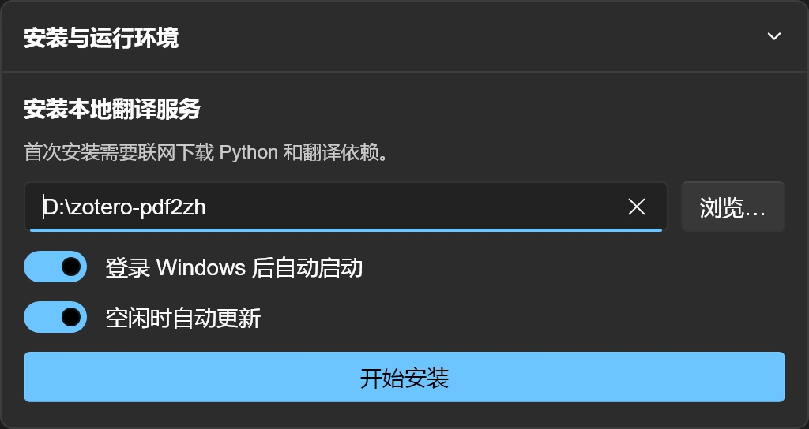
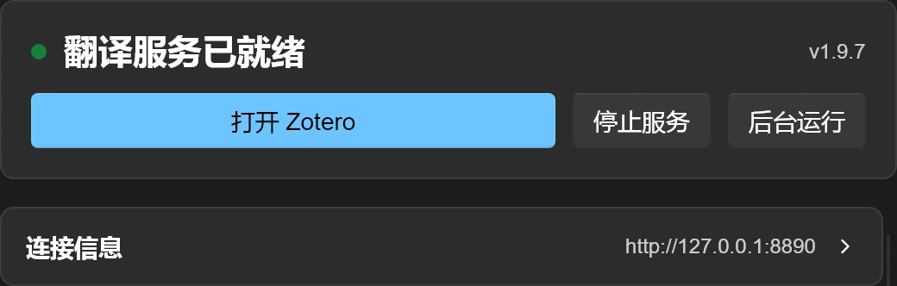
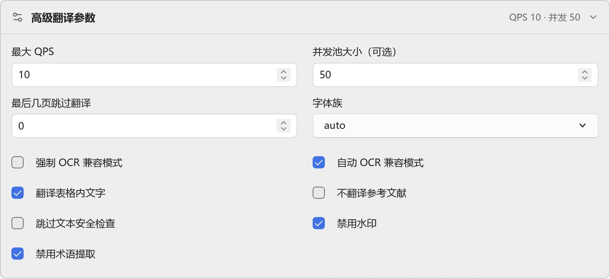
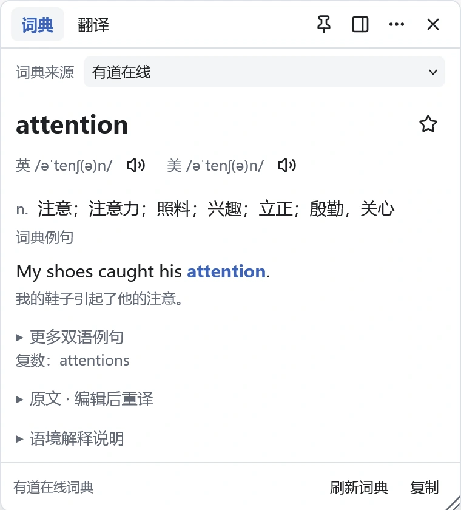
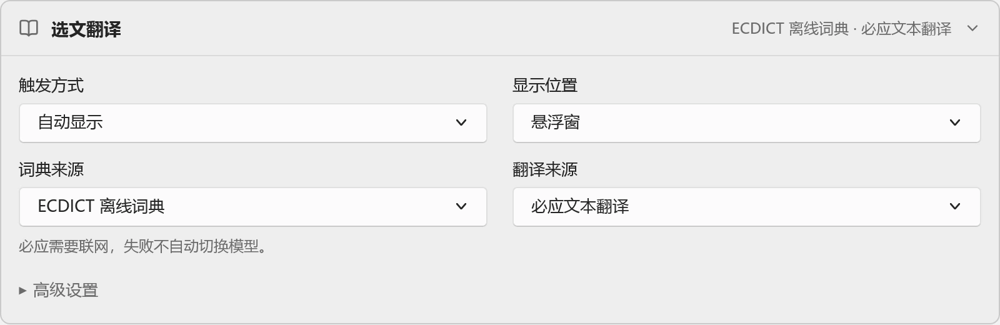
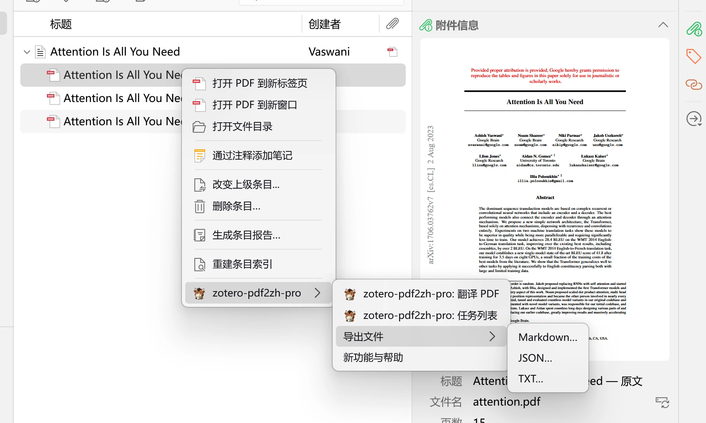

# 使用指南

<!-- Generated from website/src/content/docs/guide/*.mdx. Edit those chapters, then run python scripts/sync_guide_docs.py. -->

[返回项目首页](../README.md)

按 **本地服务 → Zotero 插件 → 翻译来源 → 第一篇 PDF** 完成首次使用。

## 目录

- [安装前准备](#quick-start)

- [Windows 安装](#windows)

- [macOS 安装](#macos)

- [安装 Zotero 插件](#installation)

- [配置翻译来源](#api-configuration)

- [翻译第一篇 PDF](#usage)

- [调整翻译参数](#translation-options)

- [任务管理与补译](#task-management)

- [划词精读](#selection-translation)

- [导出 Markdown、JSON、TXT](#export)

- [使用术语库](glossary-downloads.md)

- [更新、迁移与卸载](#maintenance)

- [常见问题](#troubleshooting)

- [诊断与反馈](#diagnostics)

- [使用 uv 手动运行](#uv)

- [Linux 与 Docker](#advanced)

<a id="quick-start"></a>

## 安装前准备

<span id="1-安装前准备"></span>


首次使用需要 **Zotero、插件、本地服务和翻译来源**。

<span id="需要安装哪些东西"></span>

### 准备这四项

| 项目 | 如何准备 |
| --- | --- |
| Zotero 8–10 | 从 [Zotero 官网](https://www.zotero.org/download/)安装 |
| 本地服务 | 按 [Windows](#windows) 或 [macOS](#macos) 教程安装；无需自行安装 Python |
| Zotero 插件 | 下载 XPI 后[从文件安装](#installation) |
| 翻译来源 | 准备 API Key，或使用已有的 [ChatGPT 套餐 / 本地模型](#api-configuration) |

插件和本地服务都要安装。Linux / Docker 用户查看[进阶部署](#advanced)。

<span id="两种地址不要填反"></span>

### 地址与费用

- **本地服务地址**：`http://127.0.0.1:8890`，填写在插件的“服务端连接”中。
- **API 地址**：由模型服务商提供，填写在翻译配置中。两者不能混用。

PDF 在本地处理；云端翻译会把待译文本发送给所选服务商，并使用其额度。

> [!TIP]
> 第一次用一篇较短、能选中文字的 PDF 测试。保持“禁用术语提取”开启，可减少额外 token 消耗。

<a id="windows"></a>

## Windows 安装

<span id="2-windows-安装教程"></span>


适用于 **Windows 10/11 x64**。首次安装需要联网下载 Python 和翻译依赖。

<span id="第一步下载并打开安装器"></span>

<span id="第二步选择安装位置并安装"></span>

### 安装并启动

1. [下载 Windows 安装器](https://github.com/study-233/zotero-pdf2zh-pro/releases/latest/download/zotero-pdf2zh-pro-windows-x64-setup.exe)，双击打开。
2. 选择安装位置，点击 **开始安装**。默认位置为 `%LOCALAPPDATA%\zotero-pdf2zh-pro`。
3. 完成后点击 **完成并启动服务**。



看到 **翻译服务已就绪**，继续[安装 Zotero 插件](#installation)。



<span id="第三步保持服务运行并安装插件"></span>

### 日常使用

- 关闭窗口或退出控制中心，已运行的服务仍会继续；需要停止时点击 **停止服务**。
- 登录自启默认开启，可在 **常规设置**中关闭。
- 翻译时保持服务运行；安装或更新前先等待当前任务结束。

<span id="如果控制中心打不开"></span>

### 安装失败或打不开

<details>
<summary>查看处理方法</summary>

| 问题 | 处理 |
| --- | --- |
| 下载失败 | 检查网络，在控制中心查看“日志与诊断”后重试 |
| 8890 端口被占用 | 检查是否已运行另一份服务，避免重复启动 |
| 旧版提示缺少 DLL | 重新下载上方 EXE 安装器，直接修复或升级，无需先卸载 |
| SmartScreen 提示风险 | 当前 EXE 未签名；核对来源和 [Release](https://github.com/study-233/zotero-pdf2zh-pro/releases/latest) 中的 SHA-256 |

</details>

<details>
<summary>旧版升级与手动恢复</summary>

同版本安装可修复，高版本可升级，不能降级；配置、数据和自启选择会保留。
从 v1.8.2 或更早版本升级时，先等翻译结束，再从旧控制中心停止服务，然后运行新安装器。

界面仍无法打开时，查看 [Windows 恢复说明](../scripts/windows/README.txt)，使用安装目录 `bin` 下的 `install.cmd`、`start-server.cmd` 或 `view-log.cmd`。

</details>

<a id="macos"></a>

## macOS 安装

<span id="3-macos-安装教程"></span>


支持 **Apple Silicon（M 系列）Mac**；Intel Mac 暂不支持当前运行时。

<span id="第一步确认-homebrew-可用"></span>

<span id="第二步安装本地服务"></span>

<span id="第三步启动并验证"></span>

### 安装服务

在“终端”执行：

```bash
brew --version
```

若提示找不到 `brew`，先[安装 Homebrew](https://brew.sh/)，完成 **Next steps** 后重开终端。
确认可用后执行：

```bash
brew tap study-233/formula
brew install --build-from-source study-233/formula/zotero-pdf2zh-pro
```

等待命令执行结束，再启动服务：

```bash
brew services start zotero-pdf2zh-pro
curl -fsS http://127.0.0.1:8890/health
```

返回 `"status":"ok"` 即为成功。终端可以关闭，接着[安装 Zotero 插件](#installation)。

<span id="日常启动停止和查看日志"></span>

### 日常启停

<details>
<summary>查看状态、停止、重启与日志命令</summary>

| 操作 | 命令 |
| --- | --- |
| 查看状态 | `brew services list`，应显示 `started` |
| 停止 | `brew services stop zotero-pdf2zh-pro` |
| 重启 | `brew services restart zotero-pdf2zh-pro` |
| 查看日志 | `tail -n 100 "$(brew --prefix)/var/log/zotero-pdf2zh-pro.log"` |

不要加 `sudo`。`start` 会启用当前用户的登录启动，`stop` 会关闭它。
停止或重启前先等翻译结束。更新已有服务请看[更新教程](#maintenance)，不要直接清理旧版本目录。

</details>

<a id="installation"></a>

## 安装 Zotero 插件

<span id="4-安装-zotero-插件与检查连接"></span>


先确认本地服务已启动。Windows 和 macOS 使用同一个 XPI。

<span id="安装-xpi"></span>

### 安装插件

1. [下载插件 XPI](https://github.com/study-233/zotero-pdf2zh-pro/releases/latest/download/zotero-pdf2zh-pro.xpi)，**不要解压**。
2. 在 Zotero 打开 **工具 → 插件**。
3. 点击齿轮，选择 **Install Plugin From File…**（部分版本为 `Install Add-on From File…`）。
4. 选择 XPI，按提示安装并重启 Zotero，确认插件已启用。


<span id="打开设置并检查本地服务"></span>

### 检查连接

1. 打开 Zotero 设置：Windows 为 **编辑 → 设置**，macOS 为 **Zotero → 设置**。
2. 选择 **zotero-pdf2zh-pro**，展开 **服务端连接**。
3. 本地服务地址填 `http://127.0.0.1:8890`，点击 **检查本地服务**。

显示 **已连接** 后，继续[配置翻译来源](#api-configuration)。


连接失败时，先确认控制中心或 Homebrew 服务已启动。

<a id="api-configuration"></a>

## 配置翻译来源

<span id="5-配置翻译-api"></span>


在 **设置 → zotero-pdf2zh-pro → 翻译配置** 中点击 **添加翻译配置**。已有配置时，点击 **管理配置 → ＋新增**。

<span id="新增第一个配置"></span>

<span id="填写-api-配置"></span>

### 使用 API Key

1. 选择平台，填写服务商提供的 **API Key** 和 **API 地址**。有预设地址时可直接使用。
2. 点击 **获取模型**并选择模型；不支持列表查询时，直接填写模型 ID。
3. 点击 **测试**。测试会发送一条短翻译请求，可能消耗少量额度。
4. 成功后点击 **保存并使用**。


**保存**仅保存编辑，**保存并使用**会切换当前来源。完成后[翻译第一篇 PDF](#usage)。

<span id="使用-chatgpt-套餐登录"></span>

### 使用 ChatGPT 套餐

1. 在 **官方接口** 中选择 **ChatGPT（使用套餐）**。
2. 点击 **使用 ChatGPT 登录**，在浏览器完成授权。
3. 返回 Zotero，获取模型、测试并 **保存并使用**。

不填写 API Key 或 API 地址，使用套餐额度。登录管理需要同一电脑上的原生服务，暂不支持 Docker 或远程登录向导。账号、用量与代理说明见 [ChatGPT 套餐指南](chatgpt-account.md)。

<span id="接口类型与模型来源"></span>

### 其他翻译来源

| 来源 | 填写内容 |
| --- | --- |
| 自定义 OpenAI 兼容 | 服务商的地址、Key 和完整模型 ID |
| Ollama | 本地模型地址和已安装的模型名，无需 Key |
| Claude Code | 先在服务所在电脑登录；需要时在高级设置填写 CLI 路径 |
| DeepL | 只填密钥，无需模型和 API 地址 |

使用云端来源时，待译文本会发送给相应服务商，费用与可用模型以账号为准。

<span id="使用-codex-登录配置"></span>

<span id="api-地址怎么填"></span>

<span id="高级设置协议和额外请求参数"></span>

<span id="管理多个配置"></span>

<span id="使用-codex-登录配置自-v181-起"></span>

### 其他设置

<details>
<summary>API 地址如何填写？</summary>

按服务商提供的地址原样填写，保留 `/v1` 或自定义前缀；插件不会自动补 `/v1`。
完整的 `/chat/completions` 或 `/responses` 地址也可使用，手动选择的协议须与后缀一致。
不要填写本地服务地址 `http://127.0.0.1:8890`。

</details>

<details>
<summary>什么时候需要高级设置？</summary>

通常保持默认：**自动（Responses 优先）**、**低推理 low**。服务商明确要求时再固定协议或修改推理设置；不支持 low 的渠道使用其可用默认设置，强制思考的模型不能关闭推理。

“额外请求参数（JSON）”默认保留 `{}`。只添加服务商明确支持的字段；不能覆盖模型、翻译输入、工具或连接设置。旧配置保留原设置，更新后可以点击“应用推荐设置”。

MiMo 套餐账号需填写套餐专用地址和对应 Key；智谱标准地址随 Chat / Responses 协议调整，旧配置应更新插件与服务后重新测试。各平台差异见[接口兼容说明](provider-audit-2026-10-03.md)。

</details>

<details>
<summary>切换或迁移已有配置</summary>

- 在“当前翻译配置”中选择后，仅影响后续新任务；已提交的批次沿用原配置。
- 管理窗口中选择一行只是编辑它；点击“保存并使用”才切换。复制、置顶、删除在“⋯”菜单中。
- 删除当前配置后需重新选择，不会自动改用其他平台。
- 旧 Codex 配置已停用，需重新添加 ChatGPT 套餐配置；独立选段翻译也要检查所选来源。
- 显示“需重新配置”或“请选择配置”时，重新选择平台并测试。旧配置备份可能包含密钥，不要公开分享。

升级影响和备份说明见[更新与迁移](#maintenance)。

</details>

<a id="usage"></a>

## 翻译第一篇 PDF

<span id="6-第一次翻译-pdf"></span>


先完成[连接与配置](#api-configuration)，并确认 PDF 已下载到本地。

<span id="设置语言与输出"></span>

<span id="从文库提交任务"></span>

### 提交翻译

1. 在插件设置中选好目标语言，并勾选需要的 **单语译文 / 双语对照** 输出。
2. 在文库展开论文条目，右键要翻译的 **原始 PDF 附件**。
3. 选择 **zotero-pdf2zh-pro → 翻译 PDF**。


<span id="确认结果并开始阅读"></span>

### 查看结果

打开 **任务列表**。任务完成且显示 **已导入** 后，在原条目下打开译文或双语附件。


翻译期间保持服务和 Zotero 开启。一个条目有多个 PDF 时，直接选择原始附件。

<span id="导出-markdownjson-和-txt"></span>

<span id="批量翻译与完成后检查"></span>

### 批量与导出

多选条目或 PDF，使用同一入口即可批量提交。单篇验证成功后再批量处理。
失败、待补译或导入失败，按[任务状态](#task-management)选择对应操作。

需要 Markdown、JSON 或 TXT？查看[文档导出](#export)，无需重新翻译。

<span id="自定义附件标题"></span>

### 附件标题与标签

<details>
<summary>自定义附件名称</summary>

在设置中开启 **自定义译文附件标题**，添加论文标题、作者、年份或模型等字段，调整顺序与分隔符，查看预览；有效修改自动保存。


- 只影响之后导入的附件，不修改 PDF 文件名或已有附件。
- 缺失字段自动跳过；删除全部字段时保留上次有效设置。
- 关闭后使用输出文件名；“恢复默认”重置组合。
- 待补译附件末尾带“（待补译）”；完整结果沿用相同命名规则。

</details>

<details>
<summary>为译文添加“已翻译”标签</summary>

在 **PDF 输出 → 完成后**开启“为完整译文添加「已翻译」标签”（默认关闭）。仅标记新导入的完整译文附件；原文、父条目和待补译附件不变，也不会为历史附件补标。

</details>

<a id="translation-options"></a>

## 调整翻译参数

<span id="7-常用翻译参数"></span>


在插件设置中展开 **高级翻译参数**。首次使用保持默认，遇到具体问题再调整。



### 常用调整

| 需要解决的问题 | 设置 |
| --- | --- |
| 返回 429、请求太快 | 降低“最大 QPS”和“并发池大小”；可从 **QPS 2、并发 4** 开始测试 |
| 保留文末附录 | 设置“最后几页跳过翻译” |
| 保留参考文献原文 | 开启“不翻译参考文献”，复杂排版需人工核对 |
| 扫描件或文字识别异常 | 单篇尝试“强制 OCR 兼容模式”，检查结果后再批量运行 |
| 减少额外 token 消耗 | 保持“禁用术语提取”开启 |

QPS 2、并发 4 是起步建议；当前默认值为 **QPS 10、并发 50**，应按服务商限额调整。

<details>
<summary>其余默认设置</summary>

| 设置 | 默认值 |
| --- | --- |
| 最后几页跳过翻译 | 0 |
| 不翻译参考文献 | 关闭 |
| 翻译表格内文字 | 开启 |
| 自动 OCR 兼容模式 | 开启 |
| 强制 OCR 兼容模式 | 关闭 |
| 禁用术语提取 | 开启 |
| 跳过文本安全检查 | 关闭 |
| 字体族 | auto |
| 禁用水印 | 开启 |

不要把“跳过文本安全检查”作为通用报错修复方式。

</details>

<a id="task-management"></a>

## 任务管理与补译

<span id="8-任务管理请求指标与补译"></span>


右键文库中的条目或 PDF，选择 **zotero-pdf2zh-pro → 任务列表**。


<span id="按任务状态选择操作"></span>

### 根据状态操作

| 状态或问题 | 操作 |
| --- | --- |
| 排队中、运行中 | 等待阶段更新，保持服务运行 |
| 待恢复 | 点击“继续任务”；恢复整个队列用“继续上次队列” |
| 失败 | 查看错误，修复连接或配置后“重试任务” |
| 未完成 | 点击“补译”，保留已验证译文，只请求剩余段落 |
| 已完成，导入失败 | 点击“重试导入”，只拉取已有结果，不重新翻译 |
| 怀疑漏译 | 点击“检查并补译” |

补译可能消耗 API 额度；新结果另存为附件，保留旧附件和批注。
“删除记录”会删除服务端任务数据和恢复检查点，操作前先保存所需结果。

<span id="看懂请求详情"></span>

### 查看详情

点击任务卡片的 **详情**，查看错误和请求指标。

<details>
<summary>如何看请求指标</summary>


- **耗时**：排队与执行的累计时间，不包含停机或等待继续。
- **QPS / 活跃请求**：当前请求速率与并发情况。
- **Token / 输出速度**：服务商回报的用量和速度；`—` 表示缺失，不能当作零消耗。
- **缓存**：本地翻译缓存与服务商缓存是两种统计。

</details>

<details>
<summary>重启、恢复与翻页</summary>

服务重启后，未开始或执行中断的任务等待手动继续，主动取消的任务不加入恢复队列。
继续、重试和补译沿用原任务配置；原 PDF 或任务目录已删除时无法恢复。

历史记录每页 30 条，活动任务和待导入结果始终显示。筛选作用于当前列表；“重试本页失败”只处理当前列表，“清理失败记录”会处理相应服务的全部失败记录。

提交时断线，可从同一原附件以相同配置再次提交找回已接收任务。不要反复更换配置重新提交。

</details>

<details>
<summary>数据保存、附件关联或记忆同步出错</summary>

- **任务记录无法安全读取**：先停止服务并备份数据目录，再核对 `tasks.json` 和 `tasks.json.bak`。不要直接覆盖原文件；备份可能缺少最近任务。
- **任务变更未能保存**：检查磁盘空间和目录权限，再重试。取消保存失败时，恢复写入后需再次取消。
- **本地附件关联损坏**：退出 Zotero 并备份 Profile，核对 `extensions.zotero.pdf2zhpro.taskBindings` 与 `taskBindingsBackup`，不要直接清空。
- **已导入附件被删除或未同步**：先恢复或下载附件，不必重译。
- **记忆同步失败**：PDF 仍可导入。修复空间、权限或占用问题后点击“重试记忆同步”；同步完成前不能删除任务。

无法判断原因时，[导出诊断包](#diagnostics)反馈。

</details>

<a id="selection-translation"></a>

## 划词精读

<span id="reader-划词与翻译记忆"></span>


在 Zotero 中打开能选中文字的 **原始 PDF**，划选即可查询。查词无需本地服务；选句翻译和语境解释需要服务运行。

<span id="查单词与短语"></span>

<span id="翻译句子与段落"></span>

### 查词与翻译

1. 划选英文单词，默认打开“词典”；句子与段落默认打开“翻译”。
2. 查看释义或译文，点击“复制”保存；需要单词译文时切到“翻译”。
3. 在页签下方切换词典或翻译来源。2–3 个英文词也可切到“词典”查短语。




若只想手动触发，在 **设置 → 选文翻译 → 触发方式**选择“点击翻译”。

<span id="个人词典与语境解释"></span>

### 选择来源

- **词典**：有道、必应、ECDICT 或柯林斯。离线词典未收录时，才查询所设在线后备。
- **选段翻译**：默认必应，无需 Key；也可跟随全文模型或独立选择已保存的配置。
- **语境解释 / AI 释义**：按需调用所选模型。使用必应时，在高级设置单独选择“AI 增强模型”。

模型翻译与语境解释可能发送当前页及相邻页的相关上下文，并消耗模型额度；必应只发送选文与语言。
查询失败会提示重试，不会自动改用付费模型。

<span id="浮窗与右侧面板"></span>

<span id="收藏与论文出处"></span>

### 收藏与阅读位置

点击词条旁的星标收藏，在右侧 **划词收藏**中搜索、复制或“回到原文”。
收藏保留论文出处，不额外调用模型；**本地保存，不随 Zotero 云同步**。备份用收藏菜单的 JSON 导出。

浮窗标题栏可以拖动，也可切到阅读器右侧面板。点击固定可保留浮窗；`Esc` 关闭浮窗，侧栏用“更多 → 清空结果”。

<span id="下载与管理词典"></span>

<span id="缓存备份与使用范围"></span>

### 更多设置

<details>
<summary>触发方式、显示位置与翻译来源</summary>



</details>

<details>
<summary>修改原文、重新翻译与流式输出</summary>

打开 **原文 · 编辑后重译**修正断行或 OCR 错字，再点击“翻译”或按 `Ctrl/Cmd + Enter`。
需要原来的文字时选择“恢复划选原文”。修订后无法匹配论文上下文时，重新划选再做语境解释。

“重新翻译”使用当前来源重新请求。支持的模型默认流式显示；“停止生成”保留已有文字供复制，但不作为成功缓存。
不支持流式时，可在“更多”中选择“使用普通模式重试”。

</details>

<details>
<summary>个人词典与柯林斯词库</summary>

词典确实未收录时，可按设置用 AI 补充释义；接口错误不会触发自动补充。
生成的释义标注模型，保存到个人词典后可跨论文复用；可在高级设置关闭“缺词时自动补充释义”。

柯林斯词库在 **选文翻译 → 高级设置**点击“下载并启用”；也支持检查更新与从文件导入。
下载失败保留旧词库；退出 Zotero 会中止下载。数据来源与许可见[词典说明](../plugin/addon/content/dictionaries/NOTICE.md)。

</details>

<details>
<summary>收藏与备份注意事项</summary>

收藏菜单支持 JSON 导入和 JSON/CSV 导出；导入合并保留本地冲突记录。
“加入术语表”是独立操作，单纯收藏不会改变全文译法。
收藏库损坏时先备份原文件与 `.bak`，恢复主文件后重启，不要直接清空。

清除翻译缓存不删除个人词典、全文记忆或收藏。迁移时备份 Zotero 数据目录的 `pdf2zhpro/`，并在停止服务后备份服务数据目录中的 `selection-cache.sqlite3`、`translation-memory.sqlite3`。这些数据不自动跨电脑同步。

当前不支持扫描件划词、译文附件反查和精确词级对齐。记忆查询失败先处理错误，不会自动转为外部请求。更多机制见[服务端说明](../server/README.md#reading-memory-and-short-text)。

</details>

<a id="export"></a>

## 导出 Markdown、JSON、TXT

将 PDF 中的内容保存为文件，**不调用翻译模型**。原文和已有译文都能导出。

### 导出文件

1. 保持本地服务运行，在 Zotero 中选中 **一个本地 PDF 附件**。
2. 右键选择 **zotero-pdf2zh-pro → 导出文件**。
3. 选择 **Markdown…、JSON… 或 TXT…**，指定保存位置。



看到 **已保存**提示后，到所选目录打开文件。
关闭进度窗口或点击“取消”会停止导出；原 PDF 与批注不会被修改。

### 选择附件与格式

- **只要译文**：选择单语译文 PDF。
- **需要原文**：选择原始 PDF。
- **双语 PDF**：导出该附件中的两种语言。

Markdown 适合笔记，JSON 适合程序处理，TXT 只保留纯文本。

### 无法导出

| 提示 | 处理 |
| --- | --- |
| 未包含可提取文字 | 扫描件先做 OCR，再导出带文字层的 PDF |
| 无法读取 PDF | 确认附件已下载、未损坏、未加密 |
| 服务不支持导出 | [更新本地服务](#maintenance)，只更新插件不够 |
| 文件过大或解析超时 | 单文件上限 512 MiB，解析限时 5 分钟；减少页数后重试 |
| 无法保存 | 检查目标文件夹权限和磁盘空间 |

服务一次处理一项导出；忙碌时等当前操作完成再试。

<a id="maintenance"></a>

## 更新、迁移与卸载

<span id="9-更新与日常维护"></span>


插件与本地服务需要分别更新。操作前先等待翻译结束，备份需要保留的数据。

<span id="更新插件和服务端"></span>

### 更新版本

| 安装方式 | 操作 |
| --- | --- |
| Zotero 插件 | 插件管理器检查更新，或[下载新 XPI](https://github.com/study-233/zotero-pdf2zh-pro/releases/latest/download/zotero-pdf2zh-pro.xpi)从文件安装 |
| Windows | 控制中心检查更新；旧控制中心使用[新安装器](#windows)升级 |
| uv | 停止服务，执行 `uv tool upgrade zotero-pdf2zh-pro`，再启动 |

macOS Homebrew 按下方命令更新。**首次迁移旧数据时保留旧版本目录**，不要提前执行清理：

```bash
brew services stop zotero-pdf2zh-pro
brew update
HOMEBREW_NO_INSTALL_CLEANUP=1 brew upgrade zotero-pdf2zh-pro
brew services start zotero-pdf2zh-pro
curl -fsS http://127.0.0.1:8890/health
```

确认 `workspace.path` 指向 `$(brew --prefix)/var/zotero-pdf2zh-pro`，旧任务、译文和术语库可用后，再按需执行 `brew cleanup zotero-pdf2zh-pro`。
若发现多个旧数据目录，先停止服务、备份并合并，迁移完成前不要清理旧版本。

<span id="数据位置与迁移"></span>

### 备份与迁移

- **服务数据**：Windows 控制中心选择“打开数据目录”；macOS / uv 查看 `/health` 的 `workspace.path`。停止服务后备份整个目录，保留任务、译文和检查点。
- **Windows 更改安装位置**：展开 **存储与维护**，在 **更改安装位置**一栏点击 **迁移**，不要直接拖动正在使用的目录。
- **划词数据**：同时备份 Zotero 数据目录下的 `pdf2zhpro/`；收藏不随云同步。

<details>
<summary>升级后配置丢失或无法调用</summary>

停用的平台和旧 Codex 配置需要重新配置；插件不会自动替换来源。重新选择平台并测试，独立选段翻译也要核对来源。

旧 API 备份可能位于 Zotero 配置编辑器的 `extensions.zotero.pdf2zhpro.llmApisLegacyBackup`，包含凭据，不要公开分享。ChatGPT 迁移见[套餐指南](chatgpt-account.md)，平台历史见[兼容记录](provider-audit-2026-10-03.md)。

</details>

<span id="卸载"></span>

### 移除软件

| 组件 | 操作 |
| --- | --- |
| Zotero 插件 | 在“工具 → 插件”中禁用或移除 |
| Windows 服务 | 从控制中心或开始菜单进入卸载，默认保留数据与日志；彻底删除前确认已备份 |
| Homebrew | 停止服务后执行 `brew uninstall zotero-pdf2zh-pro` |
| uv | 停止服务后执行 `uv tool uninstall zotero-pdf2zh-pro` |

移除插件不会自动卸载本地服务。

<a id="troubleshooting"></a>

## 常见问题

<span id="10-常见问题与排查"></span>


先判断问题出在哪一步：安装、本地连接、模型测试，还是结果导入。

### 安装失败

| 现象 | 处理 |
| --- | --- |
| Windows 安装或下载失败 | 检查网络，在控制中心查看“日志与诊断”后重试；使用[最新 EXE](#windows)，无需解压 ZIP |
| `command not found: brew` | 完成 Homebrew 的 Next steps，重新打开终端 |
| 找不到 `zotero-pdf2zh-pro` 命令 | uv 用户执行 `uv tool update-shell` 后重开终端；Homebrew 用户确认安装已成功 |
| Zotero 没有翻译菜单 | 确认版本为 8–10、插件已启用并重启；在文库中的条目或 PDF 上右键 |

### 本地服务无法连接

打开 [健康检查](http://127.0.0.1:8890/health)，应返回 `"status":"ok"`。

- **无法打开**：Windows 检查控制中心；macOS 执行 `brew services list`，确认服务已启动。
- **返回 degraded**：检查 `workspace` 中的错误、数据目录权限和磁盘空间。
- **根地址返回 404**：访问的是 `/health`，不是服务首页。
- **端口被占用**：检查是否重复启动 Homebrew、uv 或其他服务，只停止已确认属于自己的进程。

### API 测试失败

| 提示 | 处理 |
| --- | --- |
| 401 / 403 | 检查 Key、账号和模型权限，以服务商返回原因为准 |
| 404 / 模型不存在 | 核对地址前缀、协议后缀和完整模型 ID；插件不会自动补 `/v1` |
| 获取模型失败 | 手填模型 ID，再点击“测试”；列表不可用不一定影响翻译 |
| 429 | 检查额度和限额，降低 QPS 与并发后重试 |
| 超时 / 连接错误 | 检查网络、代理及站点可用性，先用短请求测试 |
| HTTPS 证书错误 | 检查系统或代理证书，不要关闭证书校验 |

本地服务连接成功，不代表上游 API 已配置正确。返回[翻译配置](#api-configuration)重新测试。

### PDF 与结果问题

| 现象 | 处理 |
| --- | --- |
| 找不到文件 | 先打开原 PDF，确认已下载到本地；直接选择目标附件 |
| 扫描件或文字异常 | 检查 OCR 选项，单篇测试后核对排版 |
| 任务未完成 | 查看失败段落后“补译”；导入失败用“重试导入” |
| 完成但没有新附件 | 查看导入状态，确认原条目仍存在；远端任务不一定关联当前文库 |
| Token / 缓存显示 — | 接口未提供统计，不代表免费或零消耗 |

仍无法解决时，[导出诊断包并反馈](#diagnostics)。

<a id="diagnostics"></a>

## 诊断与反馈

<span id="卡顿排查与诊断导出"></span>


先保留报错和相关任务，避免清理后丢失排查线索。

### 导出诊断包

1. 在任务卡片或插件设置中点击 **导出诊断包**。
2. 保存 ZIP；服务离线时也能导出已有插件记录。
3. 查看 `summary.txt` 中的缺失说明，再将包附到问题反馈。

诊断包不包含论文正文、密钥或接口地址。旧服务未记录的信息无法补回；提示缺少校验码时，更新插件和服务后重新导出。

<span id="反馈问题时提供什么"></span>

### 提交问题

在[问题反馈](https://github.com/study-233/zotero-pdf2zh-pro/issues)中提供：

- 系统、Zotero、插件和服务版本，以及安装方式。
- 复现步骤、完整报错和诊断包。

额外分享截图或日志前，移除密钥、认证头和私人文档内容；不要公开完整配置备份或任务目录。

<a id="uv"></a>

## 使用 uv 手动运行

<span id="备用方式使用-uv-手动运行"></span>


适合不使用控制中心或 Homebrew 的用户。先按 [uv 官方说明](https://docs.astral.sh/uv/getting-started/installation/)安装 uv。

### 安装与启动

```bash
uv tool install --python 3.13 zotero-pdf2zh-pro
uv tool update-shell
```

重新打开终端，再执行：

```bash
zotero-pdf2zh-pro
```

打开 [健康检查](http://127.0.0.1:8890/health)，返回 `"status":"ok"` 后继续[安装 Zotero 插件](#installation)。

### 保持服务运行

这是前台运行方式，**翻译时不要关闭终端**；按 `Ctrl+C` 停止。
启动前停止已有的 Homebrew 或其他服务，避免争用 8890 端口。

命令找不到时，重开终端并用 `uv tool list` 检查安装结果。更新与卸载见[维护教程](#maintenance)。

<a id="advanced"></a>

## Linux 与 Docker

<span id="进阶linux--docker-部署"></span>


Linux 可使用 [uv](#uv)；已有 Docker 环境时按以下步骤运行。

<span id="linux--docker"></span>

### Docker 启动

在本仓库根目录（包含 `compose.yaml`）执行：

```bash
docker compose up --build -d
curl -fsS http://127.0.0.1:8890/health
```

返回 `"status":"ok"` 后，在插件中填写可访问的服务地址。

### 端口与数据

- 数据和缓存使用 `compose.yaml` 中的卷映射保存，更新或重建前保留数据卷。
- 仅本机使用时，可将端口绑定为 `127.0.0.1:8890:8890`。
- 容器不会继承宿主机证书信任库；私有 CA 需要在容器中配置。
- ChatGPT 套餐登录向导暂不支持 Docker。

服务配置见[服务端说明](../server/README.md)，源码开发见[开发维护笔记](development-notes.md)。
